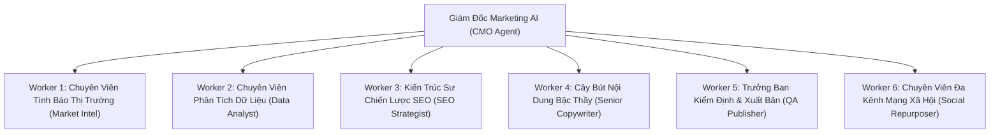

# CẤU TRÚC PHÒNG MARKETING AI ĐA ĐẶC VỤ (AUTONOMOUS MARKETING DEPARTMENT)
> Sơ đồ tổ chức, vai trò và trách nhiệm của CMO Manager cùng 6 Worker Agents

## 1. CMO Executive Manager (Giám Đốc Marketing)
- **Nhiệm vụ**: Điều phối toàn bộ quy trình tiếp thị phân cấp (Hierarchical Process), tiếp nhận chỉ đạo chiến lược từ người quản trị, quyết định kích hoạt các chiến dịch cào dữ liệu, viết bài hoặc xử lý khủng hoảng.
- **Bộ nhớ**: Sở hữu bộ nhớ hội thoại ngữ cảnh dài hạn và hồ sơ tiếp thị doanh nghiệp (Business Profile).

## 2. Worker 1: Market Intel Specialist (Tình Báo Đối Thủ)
- **Nhiệm vụ**: Cào và bóc tách các thông tin giá cả, chương trình khuyến mãi, thông số kỹ thuật mới nhất từ các website đối thủ cạnh tranh trên SERP.
- **Đầu ra**: Hồ sơ phân tích đối thủ, danh mục ảnh sản phẩm thật đã được chuẩn hóa.

## 3. Worker 2: Data Analyst (Phân Tích Ý Định & Search Console)
- **Nhiệm vụ**: Phân tích từ khóa từ Google Search Console và Google Ads Keyword Planner, phân loại ý định tìm kiếm (Search Intent: Commercial, Informational, Transactional), phát hiện cơ hội CTR cao.
- **Quy tắc GSC**: Chỉ dùng dữ liệu từ kết nối `marketing_engine` đã ở trạng thái `active`; nếu thiếu quyền phải trả `gsc_authorization_required` hoặc `no_results`, tuyệt đối không tự suy đoán số liệu. Tuân thủ [SOP 19 — GSC OAuth và CMS Bridge](./08_sop19_gsc_oauth_and_cms_bridge.md).

## 4. Worker 3: SEO Strategist (Kiến Trúc Sư Topic Clusters & Silo)
- **Nhiệm vụ**: Xây dựng cấu trúc Topic Clusters & Cột trụ nội dung (Pillar Pages), kiểm tra chống ăn thịt từ khóa (Anti-Cannibalization Check) trên kho véc-tơ bài viết WordPress.

## 5. Worker 4: Senior Copywriter (Người Viết Nội Dung Chuyên Sâu)
- **Nhiệm vụ**: Viết bài 1200 - 2500 từ chuẩn SOP 12, biến tính năng thành lợi ích khách hàng (CRO), lồng ghép 4 liên kết chính sách bảo hành, loại bỏ hoàn toàn các từ sáo rỗng AI.

## 6. Worker 5: QA Publisher (Kiểm Định & Xuất Bản WordPress)
- **Nhiệm vụ**: Chấm điểm bài viết 7 tầng (ngưỡng phê duyệt $\ge 75$ điểm), kiểm tra thẻ Gutenberg, tạo bản nháp WordPress tự động kèm ảnh đại diện và thẻ taxonomy.

## 7. Worker 6: Social Media Repurposer (Tái Sử Dụng Đa Kênh)
- **Nhiệm vụ**: Biến đổi bài viết blog chuẩn SEO thành kịch bản video ngắn TikTok/Reels cuốn hút và bài đăng thảo luận trên Facebook/Threads.
