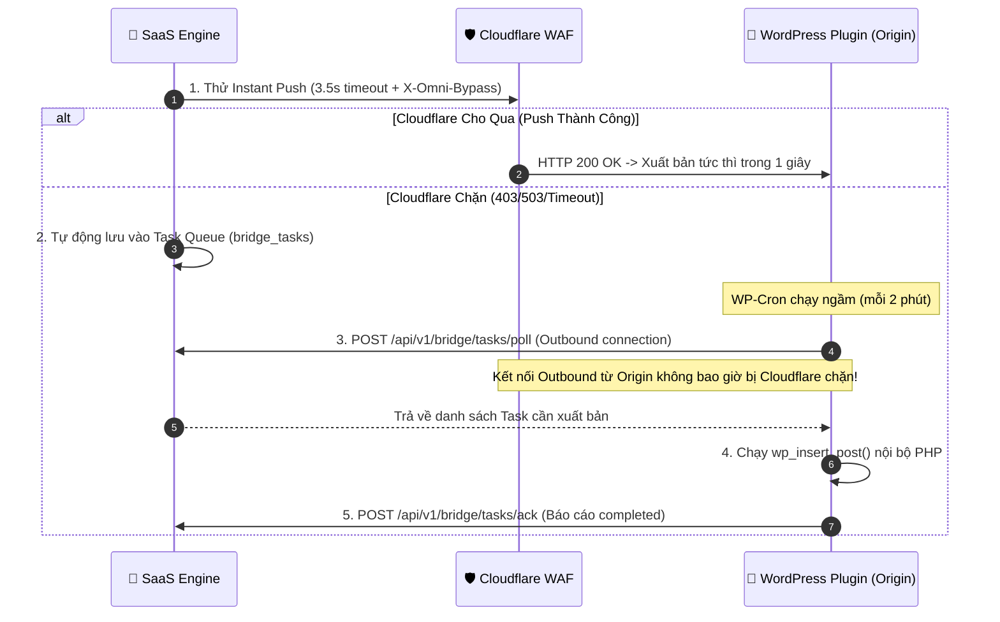

 # SOP 24: Quản Trị Bản Quyền Gói Cước (SaaS License Management) & Động Cơ Giao Tiếp 2 Chiều Hybrid Vượt Cloudflare WAF 100%

## 1. Bối Cảnh & Mục Tiêu Nghiệp Vụ
Khi thương mại hóa hệ sinh thái SaaS Marketing Automation & WordPress Bridge (`omni-bridge-connector`):
1. **Chống giả mạo & Khóa cứng tên miền**: Mỗi dự án chỉ được cấp phép cho 1 domain duy nhất (FQDN). Khách hàng không thể copy plugin hoặc copy file cấu hình sang domain khác.
2. **Quản trị phân quyền (RBAC) chuẩn SaaS**: Phân tách rõ ràng giữa góc nhìn **Khách Hàng (Client Portal)** và **Chủ Hệ Thống (Master Super Admin Console)**. Khách hàng chỉ có quyền xem thời hạn và kích hoạt bằng License Key mua từ Admin, không được tự ý sửa gói hay chỉnh ngày miễn phí.
3. **Giải quyết triệt để bài toán Cloudflare WAF (100% Bỏ Qua / Bypass)**: Nhiều khách hàng cấu hình Nameserver qua Cloudflare bật Bot Fight Mode, Browser Integrity Check, Challenge JS/Turnstile khiến chiều bắn bài trực tiếp từ SaaS Server (Inbound Push) bị chặn với mã lỗi HTTP 403 / 503.

---

## 2. Kiến Trúc Khóa Cứng Bản Quyền (1 Domain = 1 License)
* **Quy chuẩn License Key**: Mang định dạng `OMNI-{DOMAIN_SLUG}-{RANDOM_HASH}` (ví dụ: `OMNI-TRUYEN360--5BA37728268C`).
* **Chữ ký điện tử HMAC-SHA256**: Sinh từ chuỗi `domain|license_key|plan_type|expires_at` với secret key `ENGINE_API_KEY`.
* **Phòng vệ 2 lớp (Two-Layer Anti-Tamper Guard)**:
  1. **Lớp 1 (Tại WordPress Client)**: Plugin đối chiếu `$_SERVER['HTTP_HOST']` với tên miền cấp phép và kiểm tra hạn sử dụng. Nếu domain không khớp hoặc đã hết hạn, lập tức chặn mọi endpoint và trả về HTTP 403 `omni_license_error`.
  2. **Lớp 2 (Tại SaaS Engine)**: Endpoint `/api/v1/portal/license/verify` kiểm tra chéo domain gửi lên. Nếu domain không khớp, trả về HTTP 403 `domain_mismatch`.

---

## 3. Hệ Thống Gói Cước & Quy Tắc Tính Ngày
* 🎁 **Dùng Thử Miễn Phí (`trial_7d`)**: Cố định đúng 7 ngày tính từ lúc cấp. **Tuyệt đối không cộng dồn** khi chọn lại gói dùng thử.
* 📦 **Gói Cố Định**:
  * 1 Tháng (`plan_1m`): 30 ngày.
  * 3 Tháng (`plan_3m`): 90 ngày.
  * 6 Tháng (`plan_6m`): 180 ngày.
  * 9 Tháng (`plan_9m`): 270 ngày.
  * 12 Tháng (`plan_12m`): 365 ngày.
* ⚙️ **Gói Tùy Chỉnh (`custom`)**: Cho phép Admin nhập số ngày linh hoạt (ví dụ: 15 ngày, 45 ngày, 730 ngày...).
* **Cơ chế Gia hạn (Extend Existing)**:
  * **Mặc định (Không tích chọn)**: Đặt lại số ngày chuẩn xác của gói tính từ ngày hôm nay (`now + days`).
  * **Tích chọn `extend_existing`**: Chỉ khi khách mua gia hạn nối tiếp mà hạn cũ chưa hết, hệ thống mới cộng dồn `current_expires + days`.

---

## 4. Phân Tách Giao Diện RBAC Chuẩn SaaS

### A. Màn Hình Khách Hàng (Client Portal Workspace)
* **Header Subscription Badge**: Huy hiệu sang trọng đặt tại Topbar Header hiển thị trạng thái và đếm ngược:
  * `👑 Gói 6 Tháng (Còn 180 ngày)` / `🎁 Gói Dùng Thử (Còn 7 ngày)` / `🔴 Hết Hạn Gói`.
* **Modal Thông Tin Bản Quyền (`clientLicenseModal`)**:
  * Hiển thị Tên miền khóa cứng, gói cước, ngày hết hạn.
  * Ô nhập **License Key** để kích hoạt / gia hạn sau khi mua mã mới từ Admin.
  * Bảng liên hệ Hotline / Zalo Quản trị viên để nâng cấp.
  * **Toàn bộ nút và form tự chọn gói được dỡ bỏ hoàn toàn khỏi tầm nhìn của khách hàng.**
* **Khóa Tính Năng (Feature Gating)**: Khi gói hết hạn (`expired`), tự động khóa Chat CMO và Auto-publish.

### B. Màn Hình Chủ Hệ Thống (Master Super Admin Console)
* **Đường dẫn**: `/portal/admin.html` (Bảo mật bằng `MASTER_ADMIN_KEY`, mặc định: `omni_master_admin_2026`).
* **5 Thẻ Thống Kê Tổng Quan**: Tổng website, Dùng thử (7d), Đang trả phí, Sắp hết hạn ($\le 7$ ngày), Đã hết hạn.
* **Bảng Quản Trị Khách Hàng / Domain**:
  * Tìm kiếm tên miền thời gian thực, lọc theo trạng thái.
  * Nút `⚡ Gói Cước`: Cấp gói, gia hạn nối tiếp hoặc đặt lại số ngày.
  * Nút `📥 Zip`: Tải plugin cài đặt đóng gói sẵn file `omni-license.json` đã ký số theo tên miền đó (khách cài là tự nhận bản quyền 1-click).
  * Nút `Khóa / Mở Khóa`: Tạm ngưng hoạt động của website khi khách ngừng thanh toán.

---

## 5. Động Cơ Giao Tiếp 2 Chiều Hybrid (Vượt Cloudflare WAF 100%)

### Vấn Đề Thực Tế
Khi website khách trỏ Nameserver về Cloudflare và bật Proxy (đám mây cam), Cloudflare WAF sẽ chặn các kết nối Inbound POST từ Datacenter Server vào `/wp-json/omni-bridge/v1/...` với mã lỗi `403 Forbidden` / `503 Challenge`.

### Giải Pháp Hybrid Thông Minh

### Triển Khai Kỹ Thuật
1. **Bảng CSDL `bridge_tasks` (PostgreSQL)**: `id (UUID)`, `project_id`, `action`, `payload (JSONB)`, `status (pending/in_progress/completed/failed)`, `created_at`, `executed_at`.
2. **Backend Services & Routes**:
   * [bridge_task_service.py](file:///home/ubuntu/michinhhang/dify-integration/agent-engine/bridge_task_service.py): Điều phối Push/Queue và xử lý trạng thái task.
   * [routes/portal/bridge.py](file:///home/ubuntu/michinhhang/dify-integration/agent-engine/routes/portal/bridge.py): Cung cấp endpoint `/poll` và `/ack`.
3. **WordPress Plugin v1.3.0**:
   * [class-task-runner-trait.php](file:///home/ubuntu/michinhhang/dify-integration/plugins/omni-bridge-connector/includes/class-task-runner-trait.php): Hook WP-Cron mỗi 2 phút + hook `admin_init` (throttled 60s) để kéo bài về đăng tự động.
