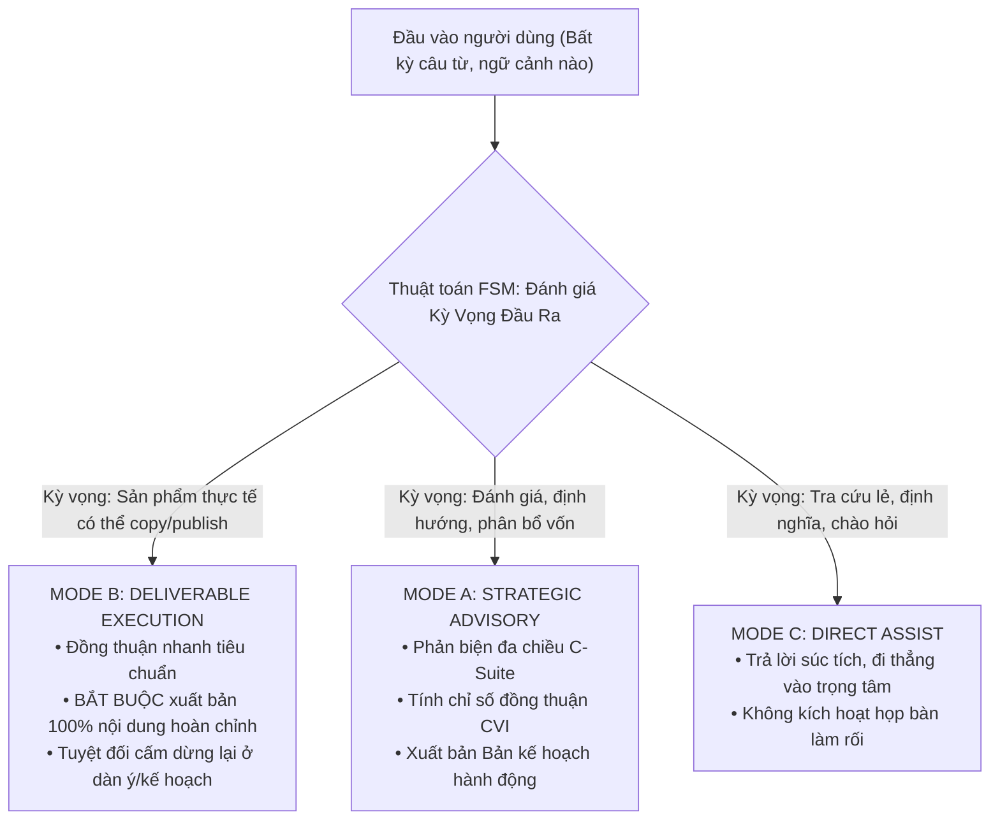

# SOP 30: NGUYÊN TẮC BẤT BIẾN "KHÔNG FIX CỨNG" (ZERO HARDCODING) & THIẾT KẾ THUẬT TOÁN THÍCH ỨNG

> [!IMPORTANT]
> **ĐIỀU LỆ TỐI CAO CỦA HỆ THỐNG TRÍ TUỆ:**
> Tuyệt đối không được phép fix cứng (hardcode) bất kỳ logic nghiệp vụ, từ khóa nhận diện, hay ngưỡng số học tùy tiện nào vào hệ thống. Trong mọi tình huống kỹ thuật, kỹ sư và AI Assistant **BẮT BUỘC phải tìm ra và áp dụng một phương án thuật toán tương ứng** để đảm bảo tính khái quát, linh hoạt và mở rộng vô hạn về sau.

---

## 1. DANH MỤC CÁC "ANTI-PATTERN" (LỖI CẤM KỴ)

Bất kỳ đoạn mã hoặc thiết kế nào vi phạm các điểm sau đều bị coi là lỗi kiến trúc nghiêm trọng:

1. ❌ **Hardcoded Keyword Matching:** 
   - Không được dùng mảng từ khóa tĩnh `["viết bài", "kế hoạch", "chiến lược"]` để rà soát văn bản người dùng `if any(k in msg)`. 
   - *Hậu quả:* Người dùng đổi từ đồng nghĩa, viết tắt, nói lóng hoặc đổi ngôn ngữ sẽ làm hệ thống bị tê liệt hoặc chạy sai luồng.
2. ❌ **Arbitrary Static Thresholds:** 
   - Không được dùng các con số giả định ngẫu nhiên (ví dụ: `len(words) >= 10`, `count > 3`, `score > 0.5` gán cứng).
   - *Hậu quả:* Bóp méo ý định thực của người dùng, phân loại sai tác vụ ngắn nhưng sâu sắc hoặc tác vụ dài nhưng đơn giản.
3. ❌ **Monolithic String Injection (Tiêm ép chuỗi thô bạo):** 
   - Không được dùng Gateway để nhồi thêm mệnh lệnh cưỡng chế (ví dụ: `[QUY TẮC BẮT BUỘC: Mở đầu bằng khối...]`) vào câu hỏi gốc của người dùng.
   - *Hậu quả:* Gây xung đột với System Prompt nội tại, sinh ra lỗi lặp cú pháp (duplicate blocks) và rò rỉ mã mô hình.
4. ❌ **Static Business Assumptions:** 
   - Không được tự tiện gán cứng giá nhập, chi phí vận chuyển, tỷ lệ quà tặng hay biên lợi nhuận vào mã nguồn hoặc câu trả lời mà không dựa trên dữ liệu động.

---

## 2. BẢNG QUY ĐỔI TỪ "FIX CỨNG" SANG "THUẬT TOÁN TƯƠNG ỨNG"

| Tình huống kỹ thuật | ❌ Cách làm fix cứng (CẤM) | ✅ Thuật toán tương ứng (BẮT BUỘC) |
| :--- | :--- | :--- |
| **Nhận diện ý định người dùng (Intent Detection)** | Rà soát mảng từ khóa `kws = ["chiến lược", ...]` | **Máy Trạng Thái Thuật Toán (Finite State Machine)** hoặc **Semantic Vector Routing** phân loại dựa trên ngữ cảnh và Kỳ vọng Đầu ra (Deliverable Expectation). |
| **Quyết định độ sâu của câu trả lời** | Đếm số lượng từ `len(words) >= 10` | **Thuật toán Phân tích Mục tiêu (Goal-Driven Decomposition)**: Tự động phân giải xem người dùng cần *Tư vấn định hướng* hay *Thực thi sản phẩm cuối*. |
| **Chấm điểm / Phân hạng rủi ro** | Gán cứng điểm cố định `score = 8.5` | **Thuật toán Ma trận Đồng thuận Đa Chiều (Consensus Voting Index - CVI)** tính trung bình trọng số giữa các tiêu chí độc lập. |
| **Tự kiểm định chất lượng nội dung** | Mặc định xuất bản bất kể đủ/thiếu | **Vòng lặp Tự Chấn Chỉnh (Self-Correction Feedback Loop)**: So sánh cấu trúc sản phẩm sinh ra với Schema kỳ vọng trước khi trả về Client. |
| **Độ trễ và kết nối thời gian dài** | Ép người dùng chờ treo trình duyệt | **Mô hình Khử Ghép Nối Bất Đồng Bộ (Decoupled Async Background Worker)** kèm hàng đợi SSE tái kết nối tự động. |

---

## 3. MÔ HÌNH THUẬT TOÁN MẪU: BỘ PHÂN LOẠI Ý ĐỊNH 3 TRẠNG THÁI (3-MODE INTENT STATE MACHINE)

Thay vì đoán từ khóa, hệ thống vận hành theo **Thuật toán Máy Trạng Thái (FSM)** tự động giải mã mục tiêu của người dùng:

---

## 4. QUY TRÌNH "TỰ VẤN THUẬT TOÁN" TRƯỚC MỌI COMMIT CODE

Trước khi viết bất kỳ dòng mã nào can thiệp vào logic xử lý, mọi kỹ sư và AI Agent bắt buộc phải vượt qua bài kiểm tra 3 câu hỏi:

1. **Câu hỏi 1 (Tính khái quát):** *"Nếu người dùng đổi cách nói bằng một từ lóng mới, viết tắt hoặc đổi sang ngôn ngữ khác, logic này có bị sập không?"* $\rightarrow$ Nếu có, phải chuyển sang thuật toán ngữ nghĩa hoặc State Machine.
2. **Câu hỏi 2 (Tính mở rộng):** *"Sau này khi thêm 50 loại nghiệp vụ mới, ta có phải mở file này ra để nhét thêm 50 câu lệnh `if/else` không?"* $\rightarrow$ Nếu có, thiết kế này vi phạm OCP (Open-Closed Principle), phải thiết kế dạng Plugin/Strategy Pattern.
3. **Câu hỏi 3 (Tính tự thích ứng):** *"Giải pháp này có để AI tự điều chỉnh dựa trên dữ liệu động hay đang bị con người cầm tay chỉ việc bằng chuỗi tĩnh?"* $\rightarrow$ Phải để AI và thuật toán tự giải mã.

---

> [!NOTE]
> Quy tắc này là kim chỉ nam vĩnh viễn cho toàn bộ hệ thống SaaS Portal, API Gateway, Dify Agent Core và các tác vụ phát triển sau này. Mọi hành vi đưa logic fix cứng vào mã nguồn đều bị coi là nợ kỹ thuật (technical debt) và phải bị refactor ngay lập tức.

