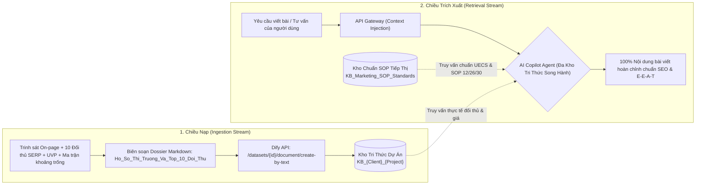

# SOP 32: CƠ CHẾ LIÊN KẾT & ĐỒNG BỘ ĐA KHO TRI THỨC RAG HAI CHIỀU (DUAL-STREAM RAG SYNCHRONIZATION)

> [!IMPORTANT]
> **MỤC TIÊU CỐT LÕI:**
> Thiết lập chuẩn mực đồng bộ hai chiều giữa dữ liệu nghiên cứu thị trường thực tế (Onboarding/Rescan) vào Kho Tri thức Dify (RAG Ingestion) và cơ chế trích xuất đa kho (Project-Specific KB + SOP Standards KB) ngược ra Cửa sổ Chat (RAG Retrieval) để phục vụ sản xuất nội dung chính xác 100%.

---

## 1. MÔ HÌNH KIẾN TRÚC RAG HAI CHIỀU



---

## 2. QUY TRÌNH NẠP TRÍ TUỆ VÀO RAG (INGESTION PIPELINE)

Hàm `sync_project_intelligence_to_rag()` tại `agent-engine/rag_service.py` đảm nhiệm:
1. **Thu thập dữ liệu định lượng:**
   - Website mục tiêu, ngành hàng kinh doanh, các đề xuất UVP từ AI.
   - Bảng 10 đối thủ hàng đầu trên SERP (Domain, trạng thái kiểm tra online, dịch vụ, điểm mạnh, điểm yếu).
   - Báo cáo phân tích khoảng trống thị trường (Category Gaps, E-E-A-T Gaps, CRO & Pricing Gaps).
2. **Đóng gói Markdown có cấu trúc:** Tạo tài liệu `Ho_So_Thi_Truong_Va_Top_10_Doi_Thu_{project_name}` có các bảng biểu phân tích rõ ràng.
3. **Phân đoạn & Đánh chỉ mục:** Sử dụng kỹ thuật `economy` hoặc `high_quality` trong Dify với chế độ `automatic` chunking để tạo vector embedding tìm kiếm ngữ nghĩa.

---

## 3. CƠ CHẾ TRÍCH XUẤT RA CỬA SỔ CHAT (RETRIEVAL PIPELINE)

Hệ thống kết hợp **2 Tầng Song Hành**:
1. **Tầng 1 - Context Injection tức thì (Zero-Latency):**
   - Gateway tiêm các biến định danh dự án sạch sẽ vào đầu prompt:
     `[BỐI CẢNH DỰ ÁN: Tên='tongkhomi.com', Website='https://tongkhomi.com', Ngành='...', UVP='...']`
   - Đảm bảo AI nắm vững định vị thương hiệu mà không phát sinh độ trễ truy vấn.
2. **Tầng 2 - Dynamic Tool Retrieval (Tra cứu RAG chủ động):**
   - Khi cần thông số chi tiết, so sánh sản phẩm đối thủ hay template bài viết, AI Agent gọi Tool tra cứu nội bộ:
     `Tool call: dataset_{project_dataset_id}({"query": "..."})`
     `Tool call: dataset_{sop_dataset_id}({"query": "..."})`
   - Dify Reranker tự động xếp hạng các phân đoạn có độ tương quan cao nhất (Top-K) để nạp vào context sinh văn bản.

---

## 4. QUY TẮC CẤU HÌNH BẮT BUỘC TRONG DIFY APP (`dataset_configs`)

Mọi ứng dụng AI Copilot phục vụ tiếp thị BẮT BUỘC phải liên kết song song **ít nhất 2 Dataset**:
1. **Dataset 1 (Project-Specific KB):** Chứa hồ sơ trinh sát thị trường và đối thủ riêng biệt của dự án đó.
2. **Dataset 2 (SOP Standards KB):** Chứa toàn bộ các tiêu chuẩn viết bài SOP 12, kinh tế khuyến mãi SOP 26, chuẩn trừu tượng hóa tri thức SOP 27, và nguyên tắc không fix cứng SOP 30.

```json
{
  "datasets": {
    "datasets": [
      {"dataset": {"enabled": true, "id": "<PROJECT_DATASET_ID>"}},
      {"dataset": {"enabled": true, "id": "<MARKETING_SOP_STANDARDS_DATASET_ID>"}}
    ]
  },
  "reranking_enable": true,
  "retrieval_model": "multiple",
  "score_threshold": 0.3,
  "top_k": 5
}
```

