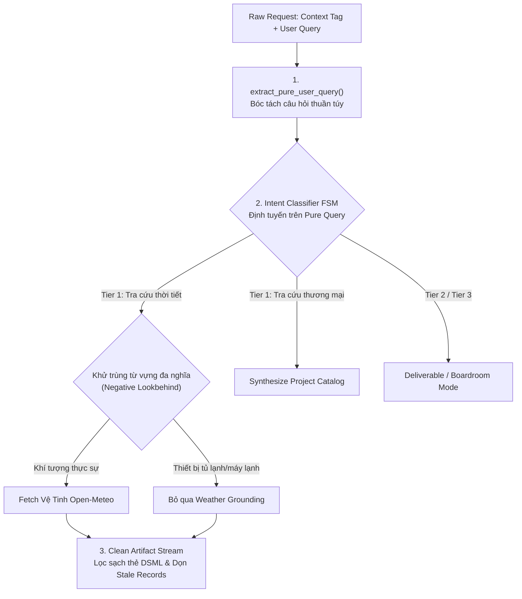

# SOP 45: TIÊU CHUẨN KHỬ TRÙNG TỪ VỰNG ĐA NGHĨA, BÓC TÁCH Ý ĐỊNH THUẦN TÚY & VỆ SINH NGỮ CẢNH (SEMANTIC INTENT DISAMBIGUATION & CONTEXT HYGIENE)

> **Phiên bản:** 1.0 — Ban hành ngày 03/11/2026  
> **Phạm vi áp dụng:** Toàn bộ API Gateway (:8085), Bộ định tuyến Ý định (Pre-Routing Grounder), Khung Chat Streaming & Dify Multi-Agent Engine.  
> **Tôn chỉ tối cao:** *"Ý định người dùng phải được bóc tách từ câu hỏi thuần túy, tuyệt đối không để ngữ cảnh tiêm cưỡng chế (Context Injection) làm biến dạng ý định; từ vựng đa nghĩa phải được khử trùng theo ngữ cảnh hành vi."*

---

## 1. BỐI CẢNH THỰC CHIẾN & BA SAI LỆCH HÀNH VI ĐƯỢC THU HOẠCH

Qua quá trình rà soát lịch sử hội thoại thực tế (Log Tracing theo SOP 43) trên hệ thống CMO AI Copilot, hệ thống phát hiện 3 sai lệch hành vi nghiêm trọng:

### 1.1. Nhiễm độc Intent do từ vựng đa nghĩa (Polysemy Collision Drift)
* **Hiện tượng:** Khi người dùng chào hỏi đơn thuần (*"Xin chào"*) hoặc hỏi giá sản phẩm (*"Tủ lạnh Xiaomi 500L giá bao nhiêu"*), hệ thống lại tự động gọi vệ tinh Open-Meteo và trả về dự báo thời tiết Hà Nội kèm trích dẫn `[1]`.
* **Căn nguyên:** Từ "lạnh" trong thiết bị gia dụng (*tủ lạnh*, *máy lạnh*, *bình nóng lạnh*) trùng với từ "lạnh" của khí tượng (*trời lạnh*, *rét*). Mẫu regex thô `\blạnh\b` đã bắt nhầm tên danh mục sản phẩm thành ý định tra cứu thời tiết.

### 1.2. Nhiễm độc bộ định tuyến do Context Injection (Context Boundary Leakage)
* **Hiện tượng:** Bộ phân loại ý định (FSM) phân tích trên toàn bộ chuỗi đã được Gateway tiêm bối cảnh:
  `[BỐI CẢNH DỰ ÁN: Tên='...', Ngành='bán tivi, tủ lạnh...']\nXin chào`
* **Hậu quả:** Các từ khóa mô tả ngành hàng (`bán`, `tủ lạnh`, `tivi`) bị FSM coi là yêu cầu thương mại hoặc thời tiết của người dùng, làm sai lệch 100% mục đích thực sự.

### 1.3. Rò rỉ thẻ suy luận mô hình & tồn dư bản ghi rỗng (Thought Artifact & Stale Stub Poisoning)
* **Hiện tượng:** Các thẻ nội bộ của LLM (`<｜DSML｜function_calls`, `<function_calls>`) bị lưu lẫn vào câu trả lời, hoặc các tin nhắn timeout/hủy bỏ để lại bản ghi rỗng (`answer = ''`) trong DB, gây lỗi dây chuyền cho các lượt chat sau.

---

## 2. BỘ BA NGUYÊN TẮC KHỬ TRÙNG NGỮ NGHĨA & VỆ SINH NGỮ CẢNH (SOP 45)



### Nguyên Tắc 1: Bóc Tách Ý Định Thuần Túy (Pure Query Extraction)
* Mọi thuật toán phân loại ý định (Intent FSM, Semantic Matching) **BẮT BUỘC** chỉ được thực thi trên câu hỏi gốc của người dùng (`pure_user_query`), đã bóc tách triệt để các khối metadata hệ thống:
  ```python
  def extract_pure_user_query(query: str) -> str:
      q = re.sub(r"\[(?:BỐI CẢNH|PROJECT CONTEXT|CHỈ THỊ|DỮ LIỆU|HỒ SƠ|QUY CHUẨN|INTENT)[^\]]*\]\s*", "", query)
      return q.strip() or query.strip()
  ```

### Nguyên Tắc 2: Khử Trùng Khái Niệm Đa Nghĩa & So Khớp Danh Mục Động (Zero Hardcoding)
* **Khí tượng:** Tuyệt đối không dùng từ đơn lẻ mơ hồ (`lạnh`) rồi fix cứng danh sách loại trừ chắp vá (`?<!tủ`, `?<!máy`). Thay vào đó, **BẮT BUỘC** nhận diện bằng Cụm Khái Niệm Khí Tượng (Meteorological Compound Phrases) như `thời tiết`, `nhiệt độ`, `dự báo thời tiết`, `trời mưa`, `nắng nóng`, `se lạnh`, `không khí lạnh`, `rét đậm`.
* **Thương mại & Danh mục Dự án:** Tuyệt đối không hardcode bất kỳ tên sản phẩm cụ thể nào (`tivi`, `tủ lạnh`, `máy giặt`) vào mã nguồn định tuyến. Thay vào đó, sử dụng Thuật toán So Khớp Ngữ Nghĩa Động (Dynamic Jaccard Overlap) giữa câu hỏi của người dùng và ma trận từ khóa `keyword_matrix` trong hồ sơ `brand_profile` của dự án. Chỉ khi có sản phẩm thực sự trùng khớp mới kích hoạt Grounding thương mại.

### Nguyên Tắc 3: Vệ Sinh Toàn Diện Bản Ghi & Khử Trùng Thẻ Mô Hình (Deep Hygiene)
1. **Dọn dẹp bản ghi rỗng tiền trạm (Pre-flight Stale Cleanup):**
   Trước khi gửi lượt prompt mới, Gateway phải quét sạch mọi bản ghi rỗng `length(trim(answer)) == 0` (bất kể `status = 'normal'` hay `'error'`) trong `conversation_id` hiện tại.
2. **Khử trùng thẻ suy luận (DSML / Function Calls Stripping):**
   Tự động bóc tách và xóa sạch mọi thẻ `<[｜|]\s*DSML\s*[｜|][^\n]*` và `<function_calls?>[\s\S]*?(</function_calls?>|$)` khỏi chuỗi hiển thị của Trợ lý AI.

---

## 3. CHECKLIST ĐỐI SOÁT TUÂN THỦ TRƯỚC KHI XUẤT BẢN
1. [x] Người dùng gõ *"Xin chào"* $\rightarrow$ AI chào hỏi thân thiện lịch thiệp, **tuyệt đối không tiêm thời tiết hay danh mục giá**.
2. [x] Người dùng hỏi *"Tủ lạnh Xiaomi 500L bao nhiêu"* $\rightarrow$ AI trả lời giá tủ lạnh, **không nhầm sang thời tiết lạnh**.
3. [x] Người dùng hỏi *"Thời tiết Hà Nội mai ra sao"* $\rightarrow$ AI kích hoạt đúng vệ tinh Open-Meteo và trích dẫn `[1]`.
4. [x] Lịch sử hội thoại không chứa bất kỳ thẻ nội bộ nào của LLM (`<｜DSML｜`).
5. [x] Không còn bản ghi rỗng `answer=''` trong cơ sở dữ liệu.

---

## 4. HỆ THỐNG MÃ NGUỒN LIÊN QUAN
* Gateway Grounding Engine: [`agent-engine/routes/portal/pre_routing_grounder.py`](file:///home/ubuntu/michinhhang/dify-integration/agent-engine/routes/portal/pre_routing_grounder.py)
* Chat Compactor & Pre-flight Cleaner: [`agent-engine/routes/portal/chat_compactor.py`](file:///home/ubuntu/michinhhang/dify-integration/agent-engine/routes/portal/chat_compactor.py)
* Stream Message Formatter: [`agent-engine/routes/portal/chat.py`](file:///home/ubuntu/michinhhang/dify-integration/agent-engine/routes/portal/chat.py)

