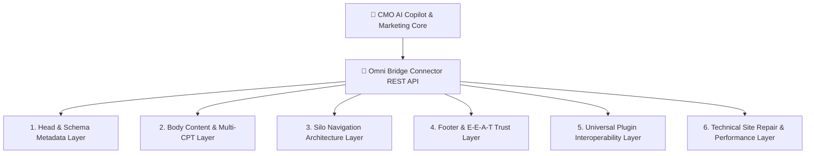
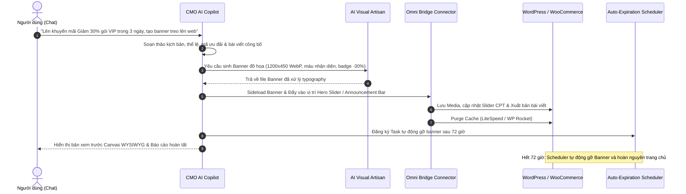

# SOP 53: HỆ ĐIỀU HÀNH CAN THIỆP CMS TOÀN NĂNG & VÒNG ĐỜI CHIẾN DỊCH KHUYẾN MÃI TỰ ĐỘNG (HEADLESS CMS CAMPAIGN LIFECYCLE & AI VISUAL ARTISAN)

> **Mã quy chuẩn:** SOP 53 — HEADLESS CMS CAMPAIGN LIFECYCLE & AI VISUAL ARTISAN  
> **Áp dụng:** CMO AI Copilot, Omni Bridge Connector, AI Visual Artisan, Hệ thống Chiến dịch Tự động  
> **Mục tiêu:** Định nghĩa toàn bộ 6 phân vùng can thiệp của Omni Bridge trên CMS và chuẩn hóa quy trình khép kín tạo chiến dịch khuyến mãi, sinh banner đồ họa và tự động treo/gỡ banner qua giao tiếp hội thoại.

---

## 1. HỆ ĐIỀU HÀNH CAN THIỆP CMS TOÀN NĂNG (THE 6 HEADLESS CMS OPERATING LAYERS)

Omni Bridge Connector không đơn thuần là plugin xuất bản bài viết, mà đóng vai trò như một **Lớp Điều Hành Không Giao Diện (Headless CMS Operating Layer)** cho phép AI can thiệp vào 6 phân vùng cốt lõi:

### 1.1. Chi tiết 6 Phân Vùng Can Thiệp

| Phân Vùng | Endpoint & Hook | Năng Lực Can Thiệp Thực Tế của AI |
| :--- | :--- | :--- |
| **1. Đầu trang (`<head>`)** | `/homepage-seo`, `wp_head` | Title 55-60 ký tự, Meta Description 155 ký tự, Canonical URL, OpenGraph, Twitter Cards, Semantic H1 ẩn, Schema Markup đa tầng (`Organization`, `WebSite`, `Book`, `Product`, `FAQPage`, `BreadcrumbList`). |
| **2. Thân trang (Nội dung & Media)** | `/publish`, `/set-featured-image`, `/categories` | Xuất bản và tái cấu trúc mọi Custom Post Type (`post`, `product`, `sab_story`, `sab_chapter`, `landing_page`); sideload ảnh bìa do AI vẽ; tự động gắn Category/Tag chuẩn ma trận từ khóa SERP; chèn box CTA và thông số WooCommerce. |
| **3. Điều hướng (Silo Navigation)** | `/silo-menu`, `wp_get_nav_menus` | Tự động kiến tạo Menu chính phân tầng Silo (Mẹ $\rightarrow$ Con $\rightarrow$ Cháu); thiết lập luồng liên kết nội bộ (Internal Linking Engine) bắt cầu giữa các bài viết/bộ truyện có cùng thực thể ngữ nghĩa. |
| **4. Chân trang (E-E-A-T Trust)** | `/legal-pages`, `wp_footer` | Tự động khởi tạo bộ 5 trang tín nhiệm E-E-A-T đa ngành; kích hoạt thanh Khiên Tín Nhiệm (Shield Trust Bar) kính mờ tự thích ứng màu môi trường; lọc sạch các khối copyright và liên kết lỗi thời. |
| **5. Cổng Đa Plugin Toàn Năng** | `/interop/execute` | Kích hoạt Action/Filter hooks (`do_action: litespeed_purge_all`, `wp_rocket_clean_domain`); tương tác với Rank Math / Yoast SEO; đọc ghi trường tùy biến ACF/Metabox; gọi hàm PHP công khai của mọi plugin. |
| **6. Kỹ thuật & Hiệu năng** | `/missing-thumbnails`, `/health`, `/gsc/performance` | Tự động quét và vá bài thiếu ảnh; cấu hình chuyển hướng 301 Redirects khi đổi slug; đối soát và đồng bộ chỉ số clicks, impressions, CTR thực tế từ Google Search Console. |

---

## 2. VÒNG ĐỜI CHIẾN DỊCH KHUYẾN MÃI TỰ ĐỘNG (AUTOMATED CAMPAIGN LIFECYCLE)

### 2.1. Quy trình Khép Kín 5 Bước

### 2.2. Tiêu chuẩn Kỹ thuật AI Visual Artisan
1. **Tỉ lệ vàng & Định dạng tối ưu:**
   - Hero Slider Desktop: `1200x450 px` (Tỉ lệ ~8:3).
   - Mobile Sticky Banner: `800x400 px` (Tỉ lệ 2:1).
   - Định dạng bắt buộc: `.webp` chất lượng nén 85%, dung lượng $\le 120$ KB để đảm bảo tốc độ tải trang dưới 0.3 giây.
2. **Typography & Nhận diện Thương hiệu:**
   - Tự động bóc tách mã màu chủ đạo từ `brand_profile` hoặc logo dự án.
   - Dán huy hiệu ưu đãi (`Badge: -30%`, `LIMITED TIME`).
   - Tiêu đề ngắn gọn ($\le 6$ từ), chữ đậm tương phản cao, dễ đọc trên cả điện thoại.

### 2.3. Tự Động Hoàn Nguyên (Auto-Expiration Lifecycle)
- Mọi chiến dịch khuyến mãi có thời hạn BẮT BUỘC gắn kèm một bản ghi `expiration_timestamp` trong bảng tác vụ nền (`bridge_task_service`).
- Khi chạm mốc hết hạn, hệ thống tự động:
  1. Ẩn hoặc xóa banner khuyến mãi khỏi Slider/Header.
  2. Cập nhật bài viết thông báo sang trạng thái `Đã kết thúc`.
  3. Kích hoạt xóa cache web tức thì (`litespeed_purge_all`).
- Triệt tiêu hoàn toàn rủi ro quên gỡ banner dẫn đến khách hàng khiếu nại về mã giảm giá quá hạn.

