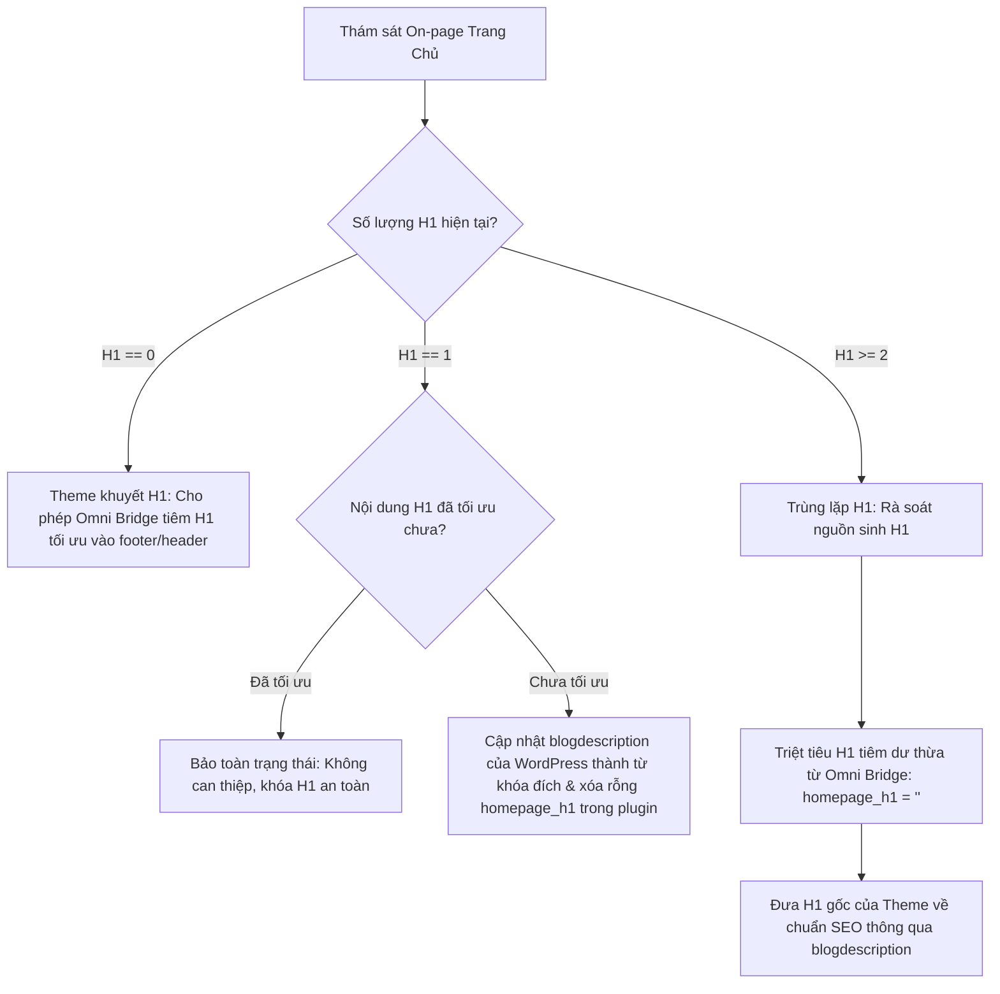

# SOP 56: ĐỐI SOÁT HEADING TỰ ĐỘNG & BẢO CHỨNG DUY NHẤT 1 THẺ H1 (AUTONOMOUS HEADING RECONCILIATION & ZERO-DUPLICATE H1)

## 1. BỐI CẢNH & NGUY CƠ SEO THỰC CHIẾN
- Trong hầu hết các theme WordPress (như `vuong-story-theme`, Astra, Flatsome), giao diện trang chủ đã mặc định xuất bản một thẻ H1 ẩn hoặc hiện thị:
  ```php
  <h1 class="sr-only"><?php bloginfo('name'); ?> - <?php bloginfo('description'); ?></h1>
  ```
- Khi hệ thống SEO tự động hoặc plugin Omni Bridge tiêm thêm một thẻ H1 bổ sung (`<h1 class="omni-seo-h1">...</h1>`) vào header hoặc footer, website lập tức bị dính lỗi **Trùng lặp nhiều thẻ H1** (`H1: 2 thẻ`), làm sụt giảm điểm On-page SEO từ 100 xuống 85-90 và khiến bot tìm kiếm phân vân về chủ đề cốt lõi.
- Người dùng khi thấy báo cáo "Trùng lặp H1" thường bấm nút "Chuẩn hóa H1", nhưng nếu logic sửa thô bạo tiếp tục inject hoặc xóa nhầm H1 của theme, lỗi không những không hết mà còn gây xung đột giao diện.

## 2. NGUYÊN TẮC THUẬT TOÁN ĐỐI SOÁT ĐỘNG (ALGORITHMIC RECONCILIATION)



### Trụ cột 1: Nhận Diện Nguồn Sinh Thẻ Heading
- Audit engine phân tích danh sách thẻ H1 bóc tách từ DOM trang chủ:
  1. H1 sinh ra từ Theme Core: Thường chứa `blogname` và `blogdescription` (tagline).
  2. H1 sinh ra từ Plugin tiêm ngoài: Mang class đặc thù hoặc nằm ngoài cấu trúc layout chính (`omni-seo-h1`, `seo-injected-h1`).

### Trụ cột 2: Thuật Toán "Tagline-First" Khử Trùng Lặp
- Khi phát hiện website đã có 1 hoặc nhiều thẻ H1 từ theme:
  - **Tuyệt đối cấm tiêm thêm H1 thứ 2.**
  - Đặt cấu hình `homepage_h1 = ""` trong thiết lập Omni Bridge để triệt tiêu mọi thẻ H1 tiêm đè.
  - Tận dụng cơ chế native của WordPress: Gọi API cập nhật tùy chọn `blogdescription` thành chuỗi từ khóa H1 tối ưu đã được CMO Copilot đề xuất (ví dụ: `Nền Tảng Đọc Truyện Chữ Online Tuyển Chọn`).
  - Khi theme render `bloginfo('name') - bloginfo('description')`, thẻ H1 duy nhất của theme tự động trở thành H1 chuẩn SEO 100% mà không sửa code theme.

### Trụ cột 3: Giao Diện Trạng Thái Thích Ứng (Dynamic Heading State UI)
- Không dùng nhãn tĩnh cứng nhắc cho mọi tình trạng.
- **Khi H1 != 1 (Trùng lặp hoặc khuyết thiếu):** Nút hiển thị màu cảnh báo `⚡ Chuẩn hóa H1`, nhấn vào sẽ tự động gửi lệnh yêu cầu Copilot lập phương án khử trùng lặp và đồng bộ lại thẻ duy nhất.
- **Khi H1 == 1 (Đã đạt chuẩn SEO hoàn hảo):** Nút tự động chuyển trạng thái dịu nhẹ `💬 Tinh chỉnh H1`, cho phép người dùng trao đổi với Copilot để đổi hướng từ khóa mục tiêu mà không báo động đỏ.

## 3. TIÊU CHUẨN KỸ THUẬT & TUÂN THỦ
- **SOP 23:** Cập nhật logic trong `agent-engine/cms_autofix_service.py` và `portal_my_site.js` duy trì $\le 300$ dòng code.
- **SOP 30:** Zero hardcoding tên theme hoặc cấu trúc HTML; nhận diện động qua mảng thẻ H1 bóc tách từ DOM thực tế.
- **Kết quả nghiệm thu:** Điểm sức khỏe On-page đạt 100/100, xác thực duy nhất 1 thẻ H1 trên môi trường Live.

