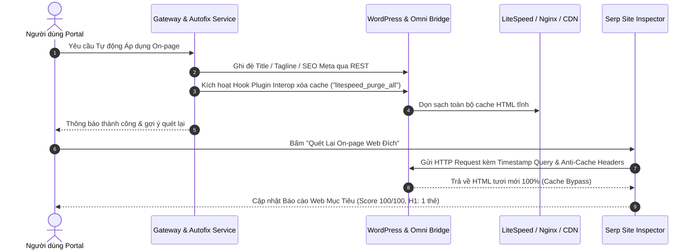

# SOP 57: KIỂM TOÁN THỜI GIAN THỰC MIỄN NHIỄM CACHE & XÓA BỘ NHỚ ĐỆM TỨC THÌ (CACHE-IMMUNE REALTIME AUDIT & INSTANT MULTI-LAYER PURGE)

## 1. BỐI CẢNH & HIỆN TƯỢNG "BÓNG MA CACHE" (GHOST CACHE)
- Trong môi trường thực tế, các website WordPress thường chạy qua nhiều tầng bộ nhớ đệm:
  1. LiteSpeed Cache (`x-litespeed-cache: hit`) hoặc WP Rocket / WP Super Cache.
  2. Nginx FastCGI Cache / Microcache (`x-fluxseo-cache: HIT`).
  3. Cloudflare CDN Edge Cache (`cf-cache-status: HIT`).
- Khi người dùng bấm nút **"⚡ Tự Động Áp Dụng Heading & On-Page Lên WordPress"**, hệ thống báo thành công rực rỡ, nhưng khi quay lại bấm **"Quét Lại On-page Web Đích"**, điểm số và danh sách thẻ Heading vẫn trơ trơ dữ liệu cũ từ 1-2 tiếng trước.
- Điều này tạo ra trải nghiệm tồi tệ: người dùng tưởng hệ thống hỏng hoặc nói dối, trong khi thực tế WordPress đã đổi nhưng bộ thu thập dữ liệu (crawler) đọc phải bản HTML cache tĩnh.

## 2. NGUYÊN TẮC KIẾN TRÚC MIỄN NHIỄM BỘ NHỚ ĐỆM (2 TRỤ CỘT)



### Trụ cột 1: Kiểm Toán Miễn Nhiễm Cache (Cache-Immune Crawling)
- Trong module kiểm toán On-page (`serp_site_inspector.py`), mọi HTTP request kiểm tra website đích bắt buộc mang:
  1. **Anti-Cache Headers:**
     ```python
     headers = {
         "User-Agent": "Mozilla/5.0 (OmniBridge-SEO-Auditor/3.0)",
         "Cache-Control": "no-cache, no-store, must-revalidate",
         "Pragma": "no-cache",
         "Expires": "0"
     }
     ```
  2. **Timestamp Query Buster:** Bổ sung tham số thời gian thực vào URL thám sát:
     ```python
     sep = '&' if '?' in url else '?'
     audit_fetch_url = f"{url}{sep}_omni_audit={int(time.time())}"
     ```
  - Cơ chế này ép buộc CDN Cloudflare, Nginx proxy và các plugin cache tầng mép phải chuyển thẳng request về PHP core, đọc ra DOM mới nhất 100%.

### Trụ cột 2: Tự Động Kích Hoạt Xóa Cache Đa Tầng Sau Khi Cập Nhật (Active Purge Dispatcher)
- Ngay sau khi thực thi sửa On-page, Heading hoặc xuất bản bài viết thành công:
  - Hệ thống kiểm tra `active_plugins` trong `site_topology` của website.
  - Nếu phát hiện LiteSpeed Cache (`litespeed-cache/litespeed-cache.php`), tự động gọi cổng Interop:
    ```python
    purge_payload = {
        "action_type": "do_action",
        "hook": "litespeed_purge_all"
    }
    await call_omni_bridge_interop(project_id, purge_payload)
    ```
  - Nếu phát hiện WP Rocket, gọi hook `rocket_clean_domain()`.
  - Nếu phát hiện W3 Total Cache, gọi `w3tc_flush_all()`.
- Việc thanh lọc bộ nhớ đệm tự động giúp toàn bộ độc giả bên ngoài và bot Google thấy ngay diện mạo chuẩn SEO mà không yêu cầu người dùng phải đăng nhập WP Admin để nhấn "Purge All".

## 3. TIÊU CHUẨN KỸ THUẬT & TUÂN THỦ
- **SOP 23:** Module `serp_site_inspector.py` duy trì $\le 300$ dòng code (thực tế 253 dòng).
- **SOP 30:** Hook xóa cache được kích hoạt dựa trên việc kiểm tra động danh sách plugin đang active từ `site_topology`, tuyệt đối không hardcode cưỡng bức.
- **SOP 44:** Surgical changes - chỉ bổ sung cờ bypass cho audit crawler, không làm biến đổi cấu trúc URL lưu trữ của dự án.

