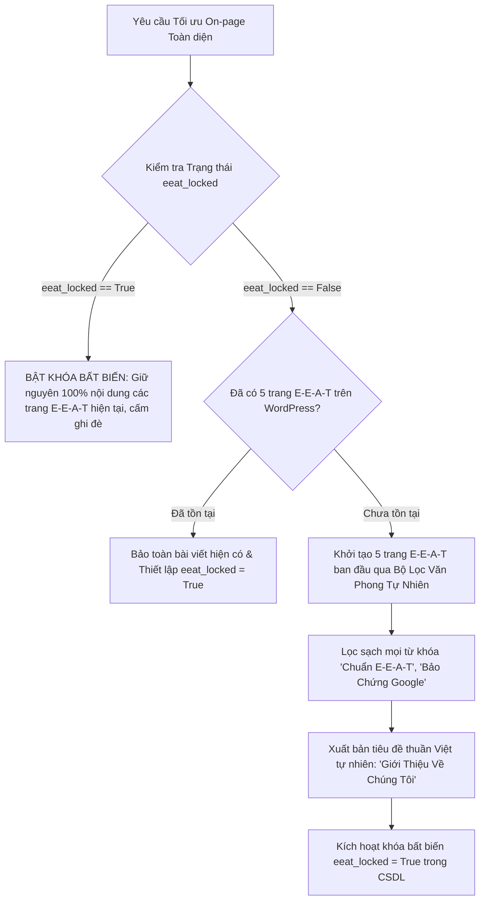

# SOP 58: KHÓA BẤT BIẾN TRANG TÍN NHIỆM & KHỬ TỪ KHÓA MÁY MÓC E-E-A-T (IMMUTABILITY LOCK GUARD & ANTI-ROBOTIC STYLOMETRY)

## 1. BỐI CẢNH & NGUY CƠ PHẢN TÁC DỤNG TÍN NHIỆM
- **Nguy cơ 1: Ghi đè hủy diệt (Destructive Overwrite):**
  - Khi người dùng bấm "Tự động áp dụng On-page" nhiều lần, nếu backend luôn gọi API tạo/sửa 5 trang pháp lý E-E-A-T (`/gioi-thieu`, `/lien-he`, `/chinh-sach-bao-mat`...), toàn bộ các chỉnh sửa thủ công quý giá của quản trị viên (số điện thoại thật, địa chỉ thật, câu chuyện sáng lập) sẽ bị ghi đè hoàn toàn bằng template AI mặc định.
- **Nguy cơ 2: Rò rỉ biệt ngữ kỹ thuật và huy hiệu máy móc (AI Hallmarks & Prompt Leakage):**
  - Tiêu đề xuất bản ra công chúng: *"Về Chúng Tôi – Nền Tảng Đọc Truyện Chữ Chuẩn E-E-A-T truyen360.top"* kèm huy hiệu vàng `🌟 BẢO CHỨNG CHẤT LƯỢNG E-E-A-T GOOGLE`.
  - Đây là biệt ngữ kỹ thuật nội bộ (engineering prompt jargon) bị rò rỉ ra front-end. Độc giả thấy website mang tính "chế tạo bằng máy", làm suy giảm nghiêm trọng độ tin cậy tự nhiên và vi phạm trực tiếp nguyên tắc đánh giá Search Quality Rater Guidelines của Google.

## 2. NGUYÊN TẮC THIẾT KẾ & THUẬT TOÁN BẢO VỆ (2 TRỤ CỘT)

### Trụ cột 1: Cơ Chế Khóa Bất Biến (Immutability Lock Guard)
1. **Lưu trữ trạng thái khóa trong CSDL:** Cột `seo_audit_cache` hoặc bảng cài đặt dự án bổ sung cờ `eeat_locked: true`.
2. **Bảo vệ tầng Plugin (`class-silo-legal-trait.php`):**
   - Khi nhận payload khởi tạo trang pháp lý từ Portal, plugin kiểm tra nếu trang (`post_name` tương ứng) đã tồn tại trong WordPress:
     - Nếu không mang cờ `$force_overwrite = true`: **Bỏ qua ghi đè (`skip_existing`)**, chỉ trả về ID bài viết hiện có.
     - Tuyệt đối không xóa bài viết viết lại, bảo vệ toàn vẹn lịch sử chỉnh sửa của chủ website.
3. **Phản chiếu giao diện Portal:** Khi đã khởi tạo xong hoặc phát hiện trang đã có, Portal gắn nhãn `[🔒 ĐÃ KHÓA BẤT BIẾN BẢO VỆ NỘI DUNG]`.

### Trụ cột 2: Khử Trùng Văn Phong Máy Móc (Anti-Robotic Stylometry Sanitizer)
- Mọi template sinh nội dung trang tín nhiệm E-E-A-T (`eeat_content_templates.py`) bắt buộc đi qua bộ lọc khử trùng:
  1. **Tiêu đề tự nhiên (Human-Centric Title):**
     - ❌ *Cũ:* `Về Chúng Tôi – Nền Tảng Đọc Truyện Chữ Chuẩn E-E-A-T truyen360.top`
     - ✅ *Chuẩn mới:* `Giới Thiệu Về Chúng Tôi – Không Gian Đọc Truyện Online truyen360.top`
  2. **Triệt tiêu huy hiệu AI tự phong:** Xóa sạch các thẻ `BẢO CHỨNG CHẤT LƯỢNG E-E-A-T GOOGLE` hoặc `TIÊU CHUẨN XẾP HẠNG TÌM KIẾM`. Google không bao giờ cấp chứng chỉ đóng dấu trên web; việc tự gắn huy hiệu giả là tín hiệu spam lộ liễu.
  3. **Văn phong biên tập viên chuyên nghiệp:** Trình bày sứ mệnh, tầm nhìn, bản quyền DMCA, chính sách bảo vệ dữ liệu độc giả bằng ngôn từ pháp lý và dịch vụ khách hàng chân thực.

## 3. TIÊU CHUẨN KỸ THUẬT & TUÂN THỦ
- **SOP 23:** File `agent-engine/eeat_content_templates.py` duy trì $\le 300$ dòng code (thực tế 280 dòng).
- **SOP 30:** Zero hardcoding ngành hàng; tự động điều chỉnh mẫu văn phong dựa theo `project_archetype` (`content_media`, `commerce_retail`, `service_health_b2b`).
- **SOP 49:** Tự động liên kết 5 trang pháp lý vào chân trang mà không gây trùng lặp.

