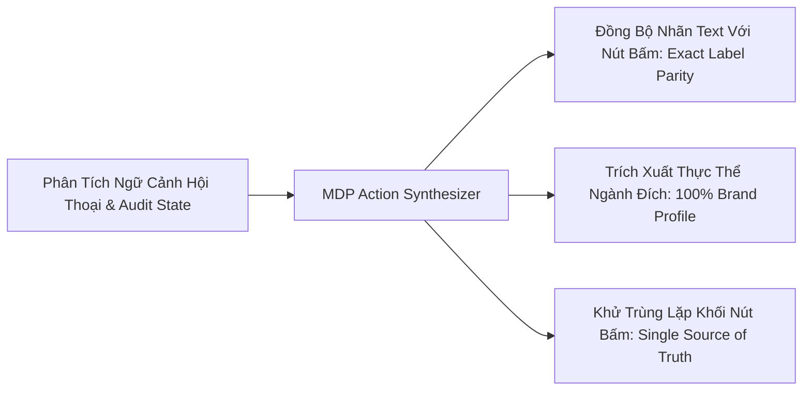

# SOP 59: ĐỒNG BỘ HÀNH ĐỘNG NGỮ CẢNH HAI CHIỀU & BẢO CHỨNG NHẤT QUÁN GIAO DIỆN (BI-DIRECTIONAL MDP CONTEXTUAL NEXT ACTIONS & UI PARITY)

## 1. BỐI CẢNH & NGHỊCH LÝ ĐỨT GÃY TRẢI NGHIỆM (UI-CHAT DISCONNECT)
- **Nghịch lý 1: Tin nhắn nhắc bấm nút nhưng giao diện không có nút (Missing Action):**
  - Trợ lý AI gợi ý trong luồng chat: *"👉 NHẤN NÚT '⚡ TỰ ĐỘNG ÁP DỤNG HEADING & ON-PAGE LÊN WORDPRESS' để hệ thống tự động..."*
  - Tuy nhiên, bên dưới tin nhắn chỉ có nút *"Mở Canvas"*, *"Xuất Bản WordPress"*, hoàn toàn không thấy nút với nhãn mà bot vừa hướng dẫn. Người dùng rơi vào tình trạng bối rối, không biết bấm vào đâu để kích hoạt.
- **Nghịch lý 2: Rò rỉ ngữ cảnh chéo ngành (Cross-Domain Leakage):**
  - Dự án là web đọc truyện chữ (`truyen360.top`), nhưng thanh tác vụ nhanh bên dưới lại đề xuất nút: `Soi đối thủ: xiaomi-vietnam.com` hoặc `Từ khóa: tivi xiaomi hà nội`.
- **Nghịch lý 3: Lặp nút thao tác dư thừa:**
  - Trang Báo Cáo Web Mục Tiêu xuất hiện cùng lúc hai hàng nút giống hệt nhau (`Quét Lại On-page Web Đích`, `Tự Động Sửa On-page (Omni Bridge)`), gây rối loạn thị giác người dùng.

## 2. NGUYÊN TẮC THIẾT KẾ & THUẬT TOÁN ĐỒNG BỘ (3 TRỤ CỘT)



### Trụ cột 1: Bảo Chứng Nhất Quán Nhãn (Exact Label Parity)
- Bất kỳ khi nào AI Copilot nhắc đến một hành động cụ thể trong văn bản:
  - Nhãn text trong câu lệnh của Bot: `'⚡ Tự Động Áp Dụng Heading & On-Page Lên WordPress'`
  - Nút bấm hành động (`action-btn` hoặc `next-action-chip`) BẮT BUỘC phải mang chính xác 100% chuỗi ký tự đó:
    ```javascript
    chips.push({
        label: "⚡ Tự Động Áp Dụng Heading & On-Page Lên WordPress",
        action: "applyOnpageFixes",
        icon: "⚡",
        primary: true
    });
    ```
- Triệt tiêu hoàn toàn sự lệch pha giữa lời hướng dẫn của AI và hệ thống điều khiển thực tế.

### Trụ cột 2: Tự Động Tổng Hợp Chủ Đề Không Hardcode (Domain Agnostic Synthesis)
- Thanh hành động nhanh gợi ý bước tiếp theo (MDP Contextual Next Actions) không được chứa bất kỳ chuỗi tĩnh nào.
- Toàn bộ danh sách gợi ý phải được tổng hợp động từ dữ liệu thực tế của dự án:
  ```javascript
  const primaryTopic = project.brand_profile?.core_topics?.[0] || project.name || "chủ lực";
  const topCompetitor = project.project_competitors?.[0]?.competitor_domain || "đối thủ Top 1";
  ```
  - Khi xem dự án `truyen360.top`: Nút hiển thị `Viết bài SOP 12: "truyện tiên hiệp"`, `Soi đối thủ: fptnovel.com`.
  - Khi xem dự án `tongkhomi.com`: Nút hiển thị `Viết bài SOP 12: "tivi xiaomi"`, `Soi đối thủ: dienmayxanh.com`.

### Trụ cột 3: Đồng Bộ Hai Chiều Giữa Trang Báo Cáo Và Khung Chat
- Các thẻ chỉ số trong tab **"Báo Cáo Web Mục Tiêu"** (Thẻ Meta Title, Meta Description, Thẻ Heading H1/H2) sở hữu các nút hành động ngữ cảnh trực tiếp:
  - Khi người dùng bấm `💬 Nhờ CMO` tại ô Meta Title $\rightarrow$ Tự động mở tab Chat và gửi prompt chuyên sâu: *"Hãy kiểm tra thẻ Meta Title hiện tại của trang web và đề xuất bản viết lại tối ưu CTR, độ dài chuẩn 40-65 ký tự"*.
  - Khi người dùng bấm `⚡ Chuẩn hóa H1` tại ô Heading $\rightarrow$ Gửi prompt: *"Thẻ Heading hiện tại đang có vấn đề (H1: 2 thẻ, H2: 3 thẻ). Hãy lập kế hoạch khắc phục duy nhất 1 thẻ H1 và phân bổ H2-H4 chuẩn SEO"*.
- Loại bỏ triệt để các hàng nút trùng lặp ở đầu trang báo cáo, giữ lại một vị trí điều khiển thanh thoát, trực quan duy nhất.

## 3. TIÊU CHUẨN KỸ THUẬT & TUÂN THỦ
- **SOP 23:** Module `portal_chat_next_actions.js` (258 dòng), `portal_chat_actions.js` (94 dòng), `portal_my_site.js` (283 dòng), `portal_my_site_actions.js` (115 dòng) đều duy trì nghiêm ngặt $\le 300$ dòng code.
- **SOP 30:** Zero hardcoding từ khóa ngành hàng hay đối thủ.
- **SOP 46:** Responsive 100% trên giao diện di động và desktop, đồng bộ font Inter thanh mảnh.

