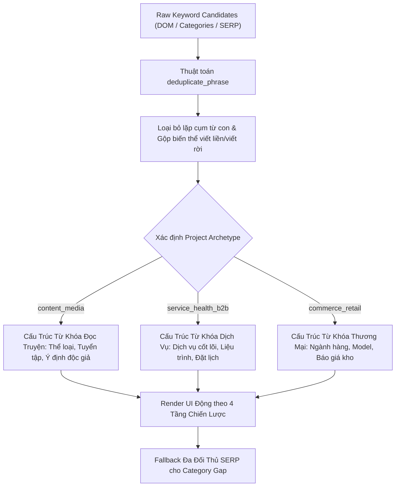

# SOP 60: PHÂN CẤP TỪ KHÓA ĐỘNG THEO ARCHETYPE & THUẬT TOÁN KHỬ TRÙNG LẶP TỪ TỐ (DYNAMIC ARCHETYPE KEYWORD TAXONOMY & TOKEN DEDUPLICATION)

## 1. BỐI CẢNH & HIỆN TƯỢNG LỆCH PHA THỰC CHIẾN
- **Lỗi 1: Ghép chuỗi thô bạo sinh lặp từ tố (Duplicate Token Compounding):**
  - Trong logic trích xuất từ khóa trước đây, hệ thống tự động cộng dồn: `Category + Brand + Suffix`.
  - Khi danh mục gốc đã chứa tên thương hiệu (như category `Truyện 360`), hệ thống ghép thêm tên thương hiệu lần 1 thành `Truyện 360 Truyen360`, rồi tiếp tục ghép ở tầng phụ thành `Truyện 360 Truyen360 Truyen360 mới nhất`, và tầng ý định thành `đọc truyện 360 truyen360 online hay nhất`.
  - Hiện tượng này khiến bộ từ khóa trông vô cùng máy móc, gây mất điểm nghiêm trọng về tính tự nhiên và thẩm mỹ ngôn ngữ.
- **Lỗi 2: Rò rỉ nhãn ngành thương mại điện tử (Cross-Domain Semantic Mismatch):**
  - Giao diện báo cáo từ khóa áp đặt các tiêu đề tĩnh của ngành bán lẻ: *"🏷️ 3. Dòng Model Sản Phẩm Đã Nhận Diện (Secondary Specs)"* và *"🛒 4. Từ Khóa Ý Định Mua Hàng & Giá Kho (Long-tail Intent)"*.
  - Khi áp dụng cho website đọc truyện chữ (`truyen360.top`) hoặc phòng khám nha khoa, người dùng thấy các nhãn "Model sản phẩm", "Giá kho" hoàn toàn lạc quẻ và vô nghĩa.
- **Lỗi 3: Khối đối chiếu danh mục bị bỏ trống và tên thương hiệu bị gán "Chưa đặt":**
  - Khi đối thủ hạt giống (Seed Competitor) chưa có trường `categories`, giao diện báo rỗng dù dự án đã cào 9-10 đối thủ SERP khác.
  - Schema lệch giữa backend và frontend khiến tên dự án `truyen360.top` bị rơi vào fallback "Chưa đặt".

## 2. NGUYÊN TẮC THIẾT KẾ & THUẬT TOÁN ĐỘNG (3 TRỤ CỘT)

### Trụ cột 1: Thuật Toán Khử Trùng Lặp Từ Tố (`deduplicate_phrase`)
- Bắt buộc áp dụng cả ở Backend (`seed_keyword_extractor.py`) lẫn Frontend Client-side (`portal_my_site_clusters.js`):
  1. **Khử lặp cụm từ con liền kề:** Dùng regex bắt các cụm từ lặp: `\b(\w+(?:\s+\w+){0,2})\s+\1\b`.
  2. **Gộp biến thể viết liền và viết rời (Compound Token Collapse):** Phân tích mảng từ tố không dấu (`truyen` + `360` vs `truyen360`). Nếu một token là tổ hợp của 2 token kề cận, tự động loại bỏ token dư thừa.
  3. **Tự nhiên hóa tiền tố tiếng Việt:** Với website truyện chữ, thay vì hậu tố thương hiệu, tự động gắn tiền tố thể loại tự nhiên: `Truyện Bách Hợp`, `Truyện Âm Giới`, `Truyện Tiên Hiệp`.

### Trụ cột 2: Phân Cấp 4 Tầng Từ Khóa Động Theo Archetype
- Giao diện bóc tách từ khóa đa tầng chuyển đổi 100% nhãn tiêu đề dựa trên biến `archetype` của dự án:
  - **Ngành Nội Dung & Đọc Truyện (`content_media`):**
    - Tầng 1: `📌 1. Thể Loại Cốt Lõi & Trụ Cột Đề Mục (Head Genres)`
    - Tầng 2: `📂 2. Tuyển Tập / Danh Mục Phân Khúc (Subcategories)`
    - Tầng 3: `🏷️ 3. Dòng Thể Loại & Tuyển Tập Thịnh Hành (Trending Collections)`
    - Tầng 4: `📖 4. Từ Khóa Ý Định Độc Giả & Khám Phá Truyện (Reading Intent)`
  - **Ngành Y Tế / Dịch Vụ B2B (`service_health_b2b`):**
    - Tầng 1: `📌 1. Dịch Vụ Cốt Lõi & Giải Pháp (Head Services)`
    - Tầng 2: `📂 2. Gói Dịch Vụ Chuyên Sâu (Subcategories)`
    - Tầng 3: `🏷️ 3. Liệu Trình & Năng Lực Chuyên Biệt (Specialized Specs)`
    - Tầng 4: `💡 4. Từ Khóa Ý Định Tư Vấn & Đặt Lịch (Consulting Intent)`
  - **Ngành Bán Lẻ / E-Commerce (`commerce_retail`):**
    - Duy trì các nhãn Ngành hàng, Phân khúc, Model sản phẩm, Ý định mua hàng & Giá kho.

### Trụ cột 3: Cơ Chế Fallback Đa Đối Thủ SERP & Phân Giải Thương Hiệu
1. **Tổng hợp danh mục từ toàn bộ tập đối thủ SERP:**
   - Nếu Seed Competitor chưa có danh mục, hệ thống tự động duyệt qua toàn bộ `project_competitors` trong CSDL để gom các chuyên mục phổ biến (`Tiên Hiệp`, `Kiếm Hiệp`, `Ngôn Tình`...).
   - Hiển thị đầy đủ khối "⚖️ Đối Chiếu Danh Mục Ngành Hàng" giúp người dùng thấy ngay các khoảng trống chuyên mục cần bổ sung.
2. **Phân giải thương hiệu kiên cường (Resilient Brand Name Resolution):**
   - Triệt tiêu lỗi rỗng: `brandNameDisplay = project.brand_name || bp.brand_name || project.name.split('.')[0].toUpperCase()`. Đảm bảo thương hiệu luôn hiển thị chỉn chu (ví dụ: `Truyện 360`).

## 3. TIÊU CHUẨN KỸ THUẬT & TUÂN THỦ
- **SOP 23:** Cả 3 file mã nguồn đều được kiểm soát nghiêm ngặt:
  - `agent-engine/seed_keyword_extractor.py`: 295 dòng ($\le 300$).
  - `agent-engine/portal/portal_my_site_clusters.js`: 132 dòng ($\le 300$).
  - `agent-engine/portal/portal_my_site.js`: 299 dòng ($\le 300$).
- **SOP 30:** Zero hardcoding từ khóa hay tiêu đề tầng; 100% thích ứng động theo `archetype`.
- **SOP 46 & 51:** Nâng timestamp cache-busting `?v=20261106_1005` trong `index.html`.

