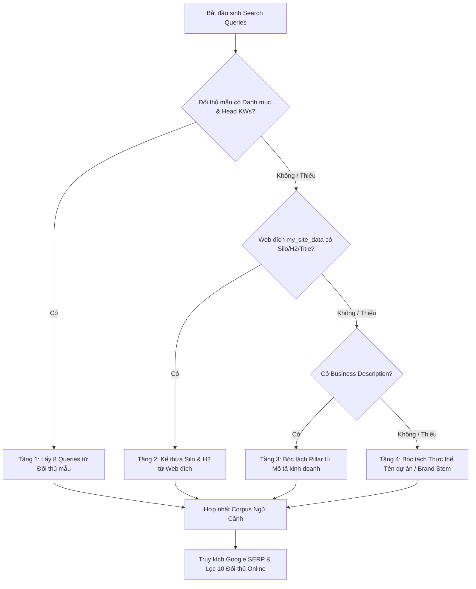

# SOP 62: CHUẨN HÓA URL TỰ ĐỘNG KHỬ LỖI GÕ PHÍM & KẾ THỪA NGỮ CẢNH ĐA TẦNG (ZERO-PROTOCOL AUTO-DETECTION & MULTI-LAYER CONTEXT INHERITANCE)

## 1. BỐI CẢNH & CÁC LỖ HỔNG PHÁT HIỆN QUA THỰC CHIẾN

Trong quá trình khởi tạo dự án và truy kích đối thủ SERP thực tế, hệ thống phát hiện 3 lỗ hổng mắt xích nghiêm trọng:
1. **Lỗi gõ phím & Thắt nút URL (Protocol Typo Bottleneck):** Người dùng vô tình nhập dư ký tự hoặc khoảng trắng (ví dụ `htttps ://mihanoi vn`). Hàm chuẩn hóa cũ chỉ kiểm tra `startswith(('http://', 'https://'))`, dẫn đến URL bị nối thành `https://htttps//mihanoi.vn`. Hostname biến thành `htttps`, làm lệnh cào Onpage sụp đổ hoàn toàn (`curl: (6) Could not resolve host`).
2. **Rơi tự do vào Fallback Thảm Họa (Catastrophic Fallback Drift):** Khi cào đối thủ hạt giống thất bại và không trích xuất được danh mục, hệ thống rơi vào fallback tĩnh: `search_queries = ["top website uy tin"]`. Google SERP tìm kiếm cụm này trả về toàn bộ **công ty thiết kế website** (`sotagroup.vn`, `hocvien.haravan.com`) thay vì đối thủ thương mại/điện máy/nội dung của dự án.
3. **Ma sát nhập liệu do thẻ HTML5 (`<input type="url">`):** Trình duyệt mặc định chặn người dùng khi họ chỉ gõ tên miền đơn thuần (`mihanoi.vn` hoặc `truyen360.top`) và hiển thị popup cảnh báo bắt buộc phải gõ `https://`, gây ức chế trải nghiệm người dùng.

---

## 2. QUY CHUẨN NHẬN DIỆN URL KHÔNG GIAO THỨC (ZERO-PROTOCOL AUTO-DETECTION)

Mọi luồng tiếp nhận URL (Tạo dự án mới, Sửa dự án, Đột kích đối thủ mẫu) BẮT BUỘC tuân thủ:

### 2.1. Phân Loại Thực Thể Tự Động & Gán Protocol Thông Minh
* **Tên miền công cộng (Public FQDN):** Bất kỳ chuỗi nào mang TLD phổ biến (`.vn`, `.com`, `.top`, `.net`, `.org`, `.edu`...) tự động gán giao thức an toàn **`https://`**.
* **Địa chỉ IP mạng riêng / Tailscale / Dev Port:** Nhận diện các dải IP (`100.`, `192.168.`, `10.`, `127.0.0.1`, `localhost`) kèm port (ví dụ `100.122.224.122:8080`) $\rightarrow$ tự động gán **`http://`** để triệt tiêu lỗi từ chối chứng chỉ SSL/TLS.
* **Bảo toàn giao thức chỉ định rõ:** Nếu người dùng chủ động gõ `https://` cho IP riêng, hệ thống tôn trọng 100% lựa chọn của người dùng.

### 2.2. Thuật Toán Khử Trùng & Sửa Lỗi Typo (`normalize_url`)
* Bóc tách và gọt sạch mọi biến thể gõ sai: `htttps://`, `htpps://`, `htt://`, `http //`, `hps://`.
* Tự động nối các khoảng trắng vô tình trước TLD: `mihanoi vn` $\rightarrow$ `mihanoi.vn`.
* Loại bỏ toàn bộ khoảng trắng thừa trong chuỗi URL.

### 2.3. Parity Giao Diện Người Dùng (Frontend UX Parity)
* Chuyển toàn bộ các thẻ `<input type="url">` sang `<input type="text" inputmode="url">`.
* Cung cấp Placeholder trực quan: `Ví dụ: mihanoi.vn hoặc http://100.122...`.
* Áp dụng hàm `clientNormalizeUrl` tại Frontend để chuẩn hóa ngay khi người dùng bấm submit hoặc rời khỏi ô nhập (`blur`).

---

## 3. THUẬT TOÁN KẾ THỪA NGỮ CẢNH ĐA TẦNG (MULTI-LAYER CONTEXT INHERITANCE)

Tuyệt đối cấm sử dụng các chuỗi fallback chung chung vô nghĩa như `"top website uy tin"`. Khi khởi tạo truy vấn trinh sát Google SERP, hệ thống kích hoạt cơ chế dự phòng 4 tầng theo thứ tự ưu tiên:

1. **Tầng 1 - Đối Thủ Mẫu:** Lấy Head keywords, Silo categories, và Extracted keywords từ `seed_audit`.
2. **Tầng 2 - Kế Thừa Web Đích (`my_site_data`):** Nếu đối thủ mẫu bị lỗi hoặc trả về rỗng, lập tức nạp `key_services_or_nav`, thẻ `H2` và `Title` từ website đích của dự án.
3. **Tầng 3 - Mô Tả Kinh Doanh:** Trích xuất các thực thể ngành hàng qua `extract_pillar_intents_from_description(business_description)`.
4. **Tầng 4 - Bóc Tách Tên Dự Án (Brand Entity Fallback):** Khử sạch các từ dừng quản trị (`test`, `demo`, `dự án`, `site`, `official`, `store`) khỏi `project_name` để lấy từ khóa cốt lõi (ví dụ: `test xiaomi` $\rightarrow$ `xiaomi chính hãng`, `xiaomi giá tốt`).

---

## 4. AN TOÀN PHẠM VI BIẾN & BẢO TOÀN KIẾN TRÚC MODULAR (SCOPE SAFETY)

* **Zero Undefined Variable:** Mọi hàm tính toán độc lập (`build_commercial_and_cro_footprint`, `build_head_to_head_matrix`) tuyệt đối không được truy cập biến toàn cục không khai báo (`target_url`), luôn tiếp nhận tham số tùy chọn hoặc bóc tách an toàn từ dictionary đối tượng (`my.get('url')`).
* **Kỷ luật SOP 23:** Mọi file mã nguồn (`seed_utils.py`, `seed_reconnaissance.py`, `seed_competitor_analyzer.py`, `seed_head_to_head.py`, `portal_project_forms.js`) BẮT BUỘC duy trì **$\le 300$ dòng code**.
* **Cache-Busting (SOP 46 & 51):** Nâng query timestamp `?v=YYYYMMDD_HHMM` trên các file JS liên quan tại `portal/index.html` mỗi lần cập nhật logic URL.

