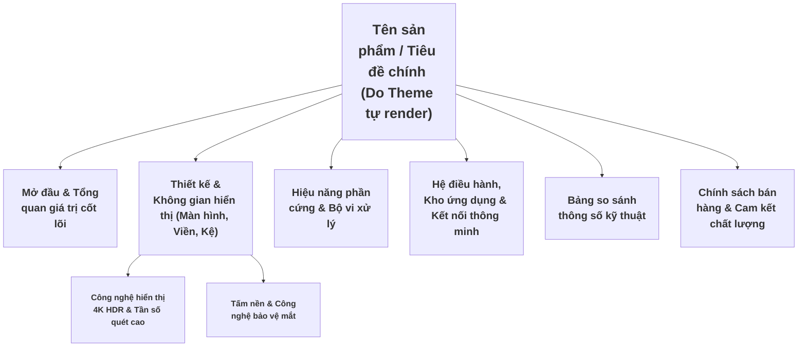
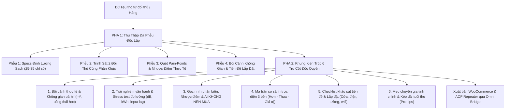

# Quy Chuẩn Viết Bài Chuẩn SEO & Tối Ưu Chuyển Đổi (Content Writing SOP)
> **Dành cho:** Content Writer Agent (CrewAI), Biên tập viên nội dung, Hệ thống tự động hóa sản phẩm & bài viết tại TongKhoMi.com.

---

## 1. Định Vị Thương Hiệu & Làm Sạch Dữ Liệu (Brand Hygiene)

Mọi bài viết sản phẩm hoặc tin tức khi được tạo mới hoặc cào dữ liệu (scrape) từ bên ngoài bắt buộc phải tuân thủ:

### A. Quy tắc làm sạch thương hiệu đối thủ:
- **Nghiêm cấm tuyệt đối:** Không để sót bất kỳ từ khóa, tên miền, số điện thoại, link hay địa chỉ của đối thủ (ví dụ: `tivixiaomihanoi`, `sudospaces`, `dienmayxanh`, `cellphones`, `lazada`, `shopee`...).
- **Chuẩn hóa thương hiệu:**
  - Tên hệ sinh thái: **TongKhoMi.com** (hoặc **Tổng Kho Xiaomi Chính Hãng**).
  - Hotline bán hàng & kỹ thuật: `0822.83.4444`.
  - Hệ thống 3 kho hàng chính thức:
    1. *Kho Đống Đa:* Số 65 Hồ Ba Mẫu, Phường Phương Liên, Quận Đống Đa, TP. Hà Nội.
    2. *Kho Hà Đông:* Sân bóng Hồ Văn Quán, Phường Văn Quán, Quận Hà Đông, TP. Hà Nội.
    3. *Kho Cảng:* Kho 86 Cảng Hà Nội, Phường Bạch Đằng, Quận Hai Bà Trưng, TP. Hà Nội.

---

## 2. Cấu Trúc Ngữ Nghĩa SEO On-Page (Semantic Heading Structure)

Trình bày bài viết theo cấu trúc kim tự tháp ngữ nghĩa chuẩn Google Search Essentials:



### Quy tắc kỹ thuật quan trọng (Crucial Technical Rules):
1. **Không nhồi nhét ảnh vào thẻ Heading:**  
   ❌ **SAI:** `<h3 class="sudo-media"><span>Tiêu đề</span></h3>`  
   ✅ **ĐÚNG:** Tách biệt rõ ràng:
   ```html
   <figure class="my-5 text-center">
       
   </figure>
   <h3 class="text-lg font-bold text-slate-800 mt-4 mb-2">Tiêu đề nội dung</h3>
   ```
2. **Không dùng inline font-family rác:**  
   - Tuyệt đối loại bỏ `style="font-family: Arial, Helvetica, sans-serif;"` hoặc font đối thủ.
   - Để CSS Theme tự động quản lý đồng bộ font chữ hệ thống (Roboto / Inter).

---

## 3. Tâm Lý Học Chuyển Đổi (CRO - Conversion Rate Optimization)

Viết bài cho sản phẩm giá trị cao (tivi, tủ lạnh, máy giặt từ 10 - 50 triệu) đòi hỏi phương pháp chuyển hóa **Tính năng (Feature)** thành **Lợi ích thực tế (Benefit)**:

| Tính năng kỹ thuật | Lợi ích diễn giải cho khách hàng |
| :--- | :--- |
| **Màn hình 120Hz/144Hz + bù chuyển động MEMC** | "Hình ảnh mượt mà tuyệt đối, loại bỏ bóng ma giật hình khi xem bóng đá Ngoại Hạng Anh hay chiến game PS5 tốc độ cao." |
| **Viền kim loại tràn viền > 97%** | "Biến tivi thành tác phẩm nghệ thuật sang trọng trong phòng khách, nâng tầm đẳng cấp không gian sống." |
| **Hệ điều hành Android TV / HyperOS tiếng Việt** | "Giao diện thuần Việt dễ dùng cho cả người lớn tuổi và trẻ nhỏ, tích hợp giọng nói tiếng Việt một chạm." |
| **Loa kép công suất lớn chuẩn Dolby Audio / DTS** | "Trải nghiệm âm thanh vòm sống động như tại rạp chiếu phim mà không cần tốn tiền mua thêm loa ngoài." |

---

## 4. Ma Trận Liên Kết Nội Bộ Bắt Buộc (Internal Linking Matrix)

Mọi bài viết sản phẩm bắt buộc phải lồng ghép tự nhiên các liên kết chính sách sau để tăng thời gian onsite và giảm tỷ lệ thoát (Bounce Rate):

1. **Chính sách bảo hành:**
   - Anchor text: *"Bảo hành chính hãng 12 - 24 tháng"*, *"Chính sách bảo hành vàng"*.
   - URL: `/chinh-sach-bao-hanh/`
2. **Chính sách đổi trả:**
   - Anchor text: *"Lỗi 1 đổi 1 trong vòng 15 - 30 ngày"*, *"Chính sách đổi trả minh bạch"*.
   - URL: `/chinh-sach-doi-tra/`
3. **Tra cứu bảo hành điện tử:**
   - Anchor text: *"Kích hoạt & tra cứu bảo hành điện tử theo Serial"*.
   - URL: `/tra-cuu-bao-hanh/`
4. **Chính sách giao nhận & vận chuyển:**
   - Anchor text: *"Giao hàng siêu tốc 60 phút nội thành"*, *"Miễn phí vận chuyển < 10km"*.
   - URL: `/chinh-sach-van-chuyen/`

---

## 5. Quy Chuẩn Minh Họa & Hình Ảnh Trong Bài

1. **Ảnh mở đầu bài viết (Hero Content Banner):**
   - Bắt buộc dùng hình ảnh phối cảnh phòng khách thực tế đã đóng mộc logo **TongKhoMi.com** chìm tinh tế (theo chuẩn `ai-docs/11-image-processing-sop.md`).
2. **Mật độ hình ảnh:**
   - Tối thiểu 1 ảnh minh họa cho mỗi đoạn văn dài 200 - 300 từ.
   - Cuối bài nên có 1 ảnh bảng thông số kỹ thuật chi tiết hoặc hình ảnh so sánh trực quan giữa các model cùng kích thước.
3. **Thẻ ALT:**
   - 100% hình ảnh phải có thuộc tính `alt="Tên sản phẩm - Tính năng mô tả"` rõ ràng, không spam từ khóa.

---

## 6. Khung Cấu Trúc Bài Viết Blog / Cẩm Nang / Đánh Giá Chuyên Sâu (10x Editorial Architecture)

> **Dành cho:** Worker viết bài SEO, tin tức công nghệ, cẩm nang tư vấn và bài đánh giá chuyên sâu (1.500 – 2.500 từ).  
> **Nguyên tắc chống cứng nhắc:** Cấm 100% câu mở đầu văn hoa sáo rỗng. Phải đi thẳng vào nỗi đau hoặc lầm tưởng thực tế, phân tích có số liệu đo lường, có bảng so sánh đa chiều và giải đáp thắc mắc người dùng.

```html
<!-- PHẦN 1: MỞ BÀI HOOK & ĐI THẲNG VÀO NỖI ĐAU THẬT -->
<p class="lead-text font-medium text-slate-800 text-lg leading-relaxed mb-6">
    [Mở đầu đi thẳng vào bài toán/mâu thuẫn thực tế của người dùng: Ví dụ việc chi hàng chục triệu mua thiết bị nhưng bị chói sáng, hao điện, hoặc kẹt giẻ tóc. Nêu rõ bài viết này sẽ bóc tách các lầm tưởng và đưa ra giải pháp thực chiến nhất].
</p>

<figure class="my-6 text-center">
    
    <figcaption class="text-xs text-slate-500 italic mt-2">[Mô tả hình ảnh bối cảnh thực tế gắn liền với chủ đề bài viết]</figcaption>
</figure>

<!-- PHẦN 2: BÓC TÁCH BẢN CHẤT CÔNG NGHỆ & GIẢI MÃ LẦM TƯỞNG -->
<h2 class="text-xl md:text-2xl font-bold text-slate-900 mt-8 mb-4 border-l-4 border-primary pl-3">
    1. Giải Mã Bản Chất Công Nghệ: Đâu Là Giá Trị Thật Và Đâu Là Thông Số Ảo?
</h2>
<p>[Phân tích chuyên sâu về công nghệ cốt lõi: chỉ ra các thông số quảng cáo bị thổi phồng, cung cấp số liệu đo lường thực tế (nhiệt độ, công suất, độ ồn dB, độ trễ ms, mức tiêu hao điện năng hàng tháng)].</p>

<!-- PHẦN 3: TÌNH HUỐNG SỬ DỤNG THỰC TẾ & CÔNG THÁI HỌC -->
<h2 class="text-xl md:text-2xl font-bold text-slate-900 mt-8 mb-4 border-l-4 border-primary pl-3">
    2. Trải Nghiệm Thực Tế Theo Từng Tình Huống Đời Thường
</h2>
<p>[Đưa ra các bối cảnh cụ thể: Căn hộ chung cư vs nhà phố; phòng ngủ ban đêm cần yên tĩnh vs phòng khách mở toang rèm ban ngày; nhu cầu giải trí bóng đá vs cày game console tốc độ cao].</p>

<!-- PHẦN 4: MA TRẬN ĐỐI SÁNH ĐA CHIỀU (GEO SCHEMA READY) -->
<h2 class="text-xl md:text-2xl font-bold text-slate-900 mt-8 mb-4 border-l-4 border-primary pl-3">
    3. Bảng Đối Sánh Các Giải Pháp & Lựa Chọn Tối Ưu Phân Khúc
</h2>
<div class="overflow-x-auto my-6">
    <table class="w-full border-collapse border border-slate-200 text-sm">
        <thead>
            <tr class="bg-slate-100 text-slate-800">
                <th class="p-3 border border-slate-200 text-left">Tiêu chí phân tích</th>
                <th class="p-3 border border-slate-200 text-left">Phương án A (Tiết kiệm)</th>
                <th class="p-3 border border-slate-200 text-left">Phương án B (Toàn diện)</th>
                <th class="p-3 border border-slate-200 text-left">Phương án C (Flagship đỉnh cao)</th>
            </tr>
        </thead>
        <tbody>
            <tr>
                <td class="p-3 border border-slate-200 font-medium">Hiệu năng thực tế</td>
                <td class="p-3 border border-slate-200">[Số liệu A]</td>
                <td class="p-3 border border-slate-200">[Số liệu B]</td>
                <td class="p-3 border border-slate-200">[Số liệu C]</td>
            </tr>
            <tr>
                <td class="p-3 border border-slate-200 font-medium">Chi phí đầu tư & Vận hành</td>
                <td class="p-3 border border-slate-200">[Chi phí A]</td>
                <td class="p-3 border border-slate-200">[Chi phí B]</td>
                <td class="p-3 border border-slate-200">[Chi phí C]</td>
            </tr>
            <tr>
                <td class="p-3 border border-slate-200 font-medium">Đối tượng phù hợp nhất</td>
                <td class="p-3 border border-slate-200">[Nhóm A]</td>
                <td class="p-3 border border-slate-200">[Nhóm B]</td>
                <td class="p-3 border border-slate-200">[Nhóm C]</td>
            </tr>
        </tbody>
    </table>
</div>

<!-- PHẦN 5: GÓC NHÌN PHẢN BIỆN: ƯU & NHƯỢC ĐIỂM THẬT -->
<h2 class="text-xl md:text-2xl font-bold text-slate-900 mt-8 mb-4 border-l-4 border-primary pl-3">
    4. Góc Nhìn Phản Biện: Những Điểm Hạn Chế Cần Cân Nhắc Trước Khi Xuống Tiền
</h2>
<p>[Thẳng thắn chỉ ra các nhược điểm, rủi ro sửa chữa, chi phí phụ kiện thay thế định kỳ để người mua có cái nhìn toàn diện 360 độ].</p>

<!-- PHẦN 6: 5 CÂU HỎI FAQ THỰC CHIẾN -->
<h2 class="text-xl md:text-2xl font-bold text-slate-900 mt-8 mb-4 border-l-4 border-primary pl-3">
    5. Giải Đáp Thắc Mắc Thường Gặp (FAQ Thực Tế)
</h2>
<div class="space-y-4 my-6">
    <div class="p-4 bg-slate-50 rounded-lg border border-slate-200">
        <h3 class="font-bold text-slate-900 mb-2">Q1: [Câu hỏi 1 sát với nỗi lo của khách hàng]?</h3>
        <p class="text-slate-700 text-sm leading-relaxed">[Câu trả lời khách quan, súc tích].</p>
    </div>
    <div class="p-4 bg-slate-50 rounded-lg border border-slate-200">
        <h3 class="font-bold text-slate-900 mb-2">Q2: [Câu hỏi 2 về bảo hành/độ bền]?</h3>
        <p class="text-slate-700 text-sm leading-relaxed">[Câu trả lời khách quan, súc tích].</p>
    </div>
</div>

<!-- PHẦN 7: CALL TO ACTION & CAM KẾT CHÍNH SÁCH -->
<h2 class="text-xl md:text-2xl font-bold text-slate-900 mt-8 mb-4 border-l-4 border-primary pl-3">
    6. Lời Khuyên Chuyên Gia & Cam Kết Dịch Vụ Tại TongKhoMi.com
</h2>
<p>
    Để lựa chọn đúng model phù hợp với diện tích và ngân sách của gia đình bạn, hãy liên hệ ngay với đội ngũ kỹ thuật của <strong>TongKhoMi.com</strong> qua hotline <strong>0822.83.4444</strong> hoặc ghé thăm hệ thống kho trực tiếp:
</p>
<ul class="list-disc pl-6 space-y-2 mb-6">
    <li>Cam kết phân phối chính hãng 100% kèm <a href="/chinh-sach-bao-hanh/" class="text-primary hover:underline font-semibold">Chính sách bảo hành chính hãng từ 12 đến 24 tháng</a>.</li>
    <li>Chính sách linh hoạt <a href="/chinh-sach-doi-tra/" class="text-primary hover:underline font-semibold">Đổi mới 1-1 trong 15 - 30 ngày</a> nếu phát sinh lỗi phần cứng.</li>
    <li>Giao hàng hỏa tốc trong 60 phút nội thành theo <a href="/chinh-sach-van-chuyen/" class="text-primary hover:underline font-semibold">Chính sách giao nhận vận chuyển</a>.</li>
    <li>Kích hoạt và quản lý bảo hành điện tử chính xác tại <a href="/tra-cuu-bao-hanh/" class="text-primary hover:underline font-semibold">Hệ thống tra cứu bảo hành</a>.</li>
</ul>
```

---

## 7. Quy Chuẩn Thẩm Định Tự Động & Chấm Điểm Bài Viết (Automated Agent Evals & LLM-as-a-Judge)

Hệ thống Microservice tích hợp Engine thẩm định tự động `EnterpriseAgentEvaluator` (`crewai-service/core/evals.py`), kiểm tra độc lập chất lượng bài viết theo 4 trọng số định lượng:

### A. 4 Tiêu Chí Chấm Điểm Trọng Số (Evaluation Weights Matrix)
1. **SOP 12 Compliance (Trọng số 30%)**:
   - Độ dài: Đạt chuẩn xuất sắc khi $\ge 1200$ từ ($100$ điểm), $800 - 1199$ từ ($85$ điểm), $< 800$ từ ($60$ điểm).
   - Heading: Tối thiểu $3$ thẻ Heading `<h2>`.
   - Mật độ từ khóa chính: Xuất hiện tự nhiên từ $2$ đến $25$ lần trong bài viết.
2. **Policy Links Integration (Trọng số 25%)**:
   - Bắt buộc lồng ghép đủ cả 4 trang chính sách: Bảo hành, Đổi trả, Bảo mật, Giao nhận vận chuyển (Mỗi chính sách thiếu trừ 25 điểm).
3. **Readability & CRO Tone (Trọng số 25%)**:
   - Lọc bỏ triệt để 8 cụm từ sáo rỗng thường gặp của AI (Mỗi lần vi phạm trừ 15 điểm):
     1. `trong thời đại số`
     2. `trong thời đại công nghệ số`
     3. `ngày nay,`
     4. `như chúng ta đã biết`
     5. `không thể phủ nhận rằng`
     6. `tóm lại,`
     7. `kết luận lại,`
     8. `bước vào kỷ nguyên`
   - Bắt buộc có lời kêu gọi hành động (Call To Action - CRO) như: *"liên hệ"*, *"hotline"*, *"mua ngay"*, *"đặt hàng"*, *"tư vấn"*, *"ưu đãi"*.
4. **Fact & Brand Integrity Guard (Trọng số 20%)**:
   - Cam kết số Hotline chuẩn `0822.83.4444`.
   - Nhận diện thương hiệu phân phối chính hãng: `TongKhoMi`, `Xiaomi`, `Viomi`, `Redmi`.

### B. Ngưỡng Phê Duyệt & Xuất Bản Tự Động (Publishing Threshold)
- Công thức tính điểm tổng hợp:
  $$\text{Overall Score} = (\text{SOP} \times 0.30) + (\text{Policy} \times 0.25) + (\text{CRO} \times 0.25) + (\text{Brand} \times 0.20)$$
- **Ngưỡng Đạt Xuất Bản**: $\ge 75.0 / 100$ điểm.
- **Dưới 75.0 điểm**: Trạng thái nhiệm vụ bị đánh dấu `NEEDS_REVIEW`, gửi cảnh báo đa kênh (Telegram/Webhook) và yêu cầu biên tập viên chỉnh sửa trước khi lên sóng.

### C. Tập Kiểm Chuẩn Vàng (Golden Benchmark Dataset)
Hệ thống sử dụng tập kiểm chuẩn chuẩn hóa gồm 5 nhóm sản phẩm Xiaomi chủ lực để tự động benchmark độ hồi quy (Regression Testing) qua endpoint `/api/v1/evals/golden-benchmark`:
1. `gb_01`: *Robot hút bụi lau nhà Xiaomi Vacuum X20+* (Robotics)
2. `gb_02`: *Máy lọc không khí Xiaomi Smart Air Purifier 4 Pro* (Home Appliances)
3. `gb_03`: *Tivi Xiaomi 85 Inch Max 4K 120Hz* (Smart Screen)
4. `gb_04`: *Camera an ninh ngoài trời Xiaomi CW400* (Smart Security)
5. `gb_05`: *Đồng hồ thông minh Xiaomi Watch 2 Pro* (Wearables)

---

## 8. Tiêu Chuẩn Nội Dung Chi Tiết Sản Phẩm Độc Quyền Toàn Diện (Universal E-Commerce Content Standard - UECS)

> **Áp dụng cho:** Tất cả các loại sản phẩm trên hệ thống E-Commerce (Điện máy, Tivi màn hình lớn, Robot hút bụi, Thiết bị gia dụng thông minh, Đồ gia dụng nhà bếp, Thiết bị văn phòng, Công nghệ âm thanh, v.v.).  
> **Mục tiêu cốt lõi:** Loại bỏ triệt để lối mòn sao chép catalogue của đối thủ. Xây dựng nội dung thực chiến, khách quan, giàu dữ liệu đo lường theo chuẩn **Google E-E-A-T** và gia tăng tỷ lệ chuyển đổi **CRO**.



### A. PHA 1: TIÊU CHUẨN THU THẬP DỮ LIỆU ĐA NGUỒN (4-Phễu Độc Lập)
1. **Phễu 1 - Thông số kỹ thuật định lượng sạch (Clean Specs Filtering):**
   - Trích xuất 25 - 35 cặp thông số kỹ thuật chuẩn dạng `[spec_label, spec_value]`.
   - **Quy tắc vàng:** Chỉ lưu trữ giá trị đo lường có số liệu + đơn vị đo lường (ví dụ: `4K (3840 x 2160)`, `4GB`, `64GB`, `1.200 Nits`, `55dB`, `220V/50Hz`).
   - **Bộ lọc loại bỏ:** Tuyệt đối cấm văn nói bán hàng, quảng cáo, cam kết giao hàng, thông tin bảo hành lọt vào trường thông số kỹ thuật.
2. **Phễu 2 - Trinh sát 2 đối thủ cạnh tranh cùng phân khúc (Competitor Recon):**
   - Tự động truy vấn 2 model đối thủ cạnh tranh trực tiếp trên thị trường (cùng phân khúc giá hoặc cùng thông số cốt lõi).
   - Trích xuất: Tên model đối thủ, giá niêm yết tham chiếu, ưu thế và hạn chế tương đối.
3. **Phễu 3 - Quét "Pain-Points" & Đánh giá nhược điểm thực tế (User Voice Mining):**
   - Quét các thảo luận từ diễn đàn, hội nhóm và đánh giá thực tế của người dùng: Tiếng ồn ban đêm, kích thước cồng kềnh, app khó kết nối, hao pin, độ nhăn quần áo, v.v.
   - Thu thập dữ liệu phục vụ trực tiếp cho trụ cột phản biện "Ai KHÔNG nên mua".
4. **Phễu 4 - Bối cảnh công thái học & Môi trường sử dụng (Ergonomics & Environmental Fit):**
   - Xác định các điều kiện không gian thực tế: Diện tích phòng tối thiểu/tối ưu (m²), khoảng cách xem/sử dụng, yêu cầu nguồn điện, tải trọng tường/sàn, độ thông thoáng.

---

### B. PHA 2: KHUNG KIẾN TRÚC 6 TRỤ CỘT NỘI DUNG ĐỘC QUYỀN

Mọi bài viết chi tiết sản phẩm bắt buộc phải có độ dài từ **1.200 đến 2.200 từ** và triển khai đầy đủ 6 khối nội dung chuyên sâu:

#### 1. Trụ cột 1: Định Vị Giải Pháp & Bối Cảnh Thực Tế (Target Persona & Setup Context)
- **CẤM TUYỆT ĐỐI** các câu mở bài rập khuôn của AI (*"Sản phẩm này là sự lựa chọn hoàn hảo...", "Trong thế giới công nghệ hiện đại...", "Ngày nay nhu cầu..."*).
- Đi thẳng vào giải quyết vấn đề: Sản phẩm sinh ra để thay thế giải pháp cũ nào?
- Định lượng không gian thực tế: Diện tích phòng phù hợp (m²), khoảng cách sử dụng chuẩn công thái học, số người sử dụng tối ưu trong gia đình.

#### 2. Trụ cột 2: Trải Nghiệm Vận Hành & Đo Lường Thực Tế (Real-Use Stress Test)
- Đánh giá có số liệu đo lường thực tế dựa trên 3 thông số cốt lõi của ngành hàng:
  - *Nghe nhìn / Màn hình lớn:* Độ sáng thực tế dưới nắng gắt (Nits), độ sâu màu đen khi tắt đèn, độ trễ input lag (ms) khi cắm PS5/PC gaming.
  - *Robot hút bụi / Làm sạch:* Khả năng vượt gờ cửa (mm), lực hút đo thực trên thảm lông dày, cơ chế gỡ tóc rối tự động, độ ồn trạm giặt giẻ.
  - *Gia dụng nhiệt / Nhà bếp:* Độ đồng đều nhiệt độ giữa các góc lòng nồi, độ tiện lợi khi vệ sinh bằng máy rửa bát.
  - *Máy lọc không khí / Xử lý môi trường:* Tốc độ làm sạch CADR thực tế sau 15 phút, mức tiêu thụ điện khi chạy liên tục 24/7.

#### 3. Trụ cột 3: Góc Nhìn Phản Biện - Nhược Điểm & Ai KHÔNG NÊN MUA (Anti-Persona & Honest Limitations)
- **Điểm khác biệt lớn nhất tạo nên niềm tin tuyệt đối với khách hàng (100% đối thủ không dám viết):** Thẳng thắn nêu 2-3 nhược điểm không thể chối cãi.
- Phân loại rõ ràng cho người đọc:
  - **NÊN MUA NẾU:** Khách hàng cần tính năng A, ưu tiên độ bền, không gian phòng rộng...
  - **KHÔNG NÊN MUA NẾU:** Phòng quá nhỏ dưới X m², ngân sách tiết kiệm, hoặc nhu cầu Y mà sản phẩm khác làm tốt hơn.

#### 4. Trụ cột 4: Ma Trận Đối Sánh Trực Diện 2 Đối Thủ Cùng Phân Khúc (Universal Competitor Matrix)
- Xây dựng bảng so sánh 3 cột: `[Sản phẩm hiện tại]` vs `[Đối thủ A]` vs `[Đối thủ B]`.
- Phân tích khách quan:
  - **Điểm vượt trội:** Vô địch về yếu tố nào (Hiệu năng trên giá thành, công nghệ màn hình, dung lượng pin, bảo hành)?
  - **Điểm thua kém:** Kém đối thủ ở chi tiết nào (Thương hiệu nhận diện, vật liệu phụ trợ, hệ sinh thái phần mềm)?

#### 5. Trụ cột 5: Checklist Khảo Sát Lắp Đặt & Điều Kiện Tiền Đề (Prerequisites & Installation)
- Hướng dẫn khách hàng kiểm tra thực tế trước khi mua:
  - Kích thước cửa ra vào, hành lang, tải trọng thang máy (đối với hàng cồng kềnh).
  - Yêu cầu nguồn điện (ổ cắm 3 chấu, đường dây chịu tải 2.000W+).
  - Kết cấu tường treo (bê tông đặc vs vách thạch cao cần gia cố khung sắt).
  - Băng tần Wi-Fi yêu cầu (2.4GHz riêng biệt cho thiết bị Smart Home).

#### 6. Trụ cột 6: Bí Quyết Tinh Chỉnh & Kéo Dài Tuổi Thọ (Pro-Tips & Maintenance)
- Các mẹo chuyên gia mà sách hướng dẫn sử dụng của hãng không đề cập:
  - Cài đặt chế độ hình ảnh chuẩn điện ảnh (tắt hiệu ứng bù hình xà phòng soap opera).
  - Mẹo kết nối âm thanh chất lượng cao eARC passthrough.
  - Chu kỳ vệ sinh màng lọc, bảo dưỡng định kỳ giúp tăng gấp đôi tuổi thọ thiết bị.

---

### C. BẢNG MA TRẬN ỨNG DỤNG CHO CÁC NHÓM NGÀNH HÀNG KHÁC NHAU

| Nhóm ngành hàng | Trụ cột 1: Bối cảnh không gian | Trụ cột 2: Đo lường thực tế | Trụ cột 3: Ai KHÔNG nên mua | Trụ cột 5: Checklist tiền đề |
| :--- | :--- | :--- | :--- | :--- |
| **Màn hình lớn / Tivi 85 - 100 inch** | Phòng khách $\ge 35\text{m}^2$, khoảng cách xem $3.8\text{m} - 5.5\text{m}$. | Độ sáng peak 1.200+ nits chống chói, 144Hz VRR input lag $< 6\text{ms}$. | Phòng nhỏ $< 25\text{m}^2$; tường thạch cao không có khung chịu lực gia cố. | Cửa thang máy cao $\ge 2.2\text{m}$; tải trọng tường $\ge 70\text{kg}$. |
| **Robot hút bụi lau nhà đa năng** | Căn hộ chung cư $80 - 150\text{m}^2$, gia đình có nuôi thú cưng rụng lông. | Lực hút thực tế trên thảm dày; tỷ lệ gỡ tóc rối; độ ồn trạm tự giặt giẻ. | Nhà nhiều tầng không có thang máy; mặt sàn quá bừa bãi nhiều dây điện. | Vị trí đặt Dock sạc thoáng (0.5m hai bên, 1.5m trước); Wi-Fi phát 2.4GHz. |
| **Máy lọc không khí gia đình** | Phòng ngủ $20 - 40\text{m}^2$ gần mặt đường lớn nhiều bụi mịn hoặc khói thuốc. | Tốc độ CADR đo sau 15 phút; mức tiêu thụ điện chạy ban đêm ở Sleep Mode. | Phòng khách mở cửa sổ thông gió liên tục (lọc không kịp, hao lõi nhanh). | Đặt cách tường $\ge 20\text{cm}$; chu kỳ thay màng lọc HEPA 6-9 tháng. |
| **Máy giặt sấy bơm nhiệt (Heatpump)** | Căn hộ ban công hẹp không phơi được đồ; gia đình miền Bắc mùa nồm ẩm. | Độ ẩm vải sau chu trình sấy; nhiệt độ sấy an toàn cho sợi len/lụa; độ rung khi vắt 1400rpm. | Khách hàng có sân phơi nắng rộng và ưu tiên tiết kiệm vốn ban đầu. | Đường cấp/thoát nước áp lực tốt; sàn bê tông phẳng chịu lực chống rung. |
| **Nồi chiên không dầu & Thiết bị bếp** | Gia đình 4-6 người ăn uống heathy, cần chuẩn bị bữa ăn nhanh gọn. | Độ phân bổ nhiệt đều khắp khay nướng; độ tiện lợi tháo lắp rửa bằng máy rửa bát. | Nhu cầu nướng gà nguyên con $> 3.5\text{kg}$ hoặc nướng bánh gato chuyên nghiệp. | Ổ cắm điện bếp chịu tải $\ge 2.000\text{W}$; khoảng hở thoát nhiệt cách tường $\ge 15\text{cm}$. |


