# TÀI LIỆU KIẾN TRÚC & SOP 17: PHÒNG MARKETING AI THƯƠNG MẠI HÓA (MULTI-TENANT SAAS) & TRÍ TUỆ DỰ ÁN LÂU DÀI (POSTGRESQL + DIFY RAG)

> **Phạm vi**: Kiến trúc nền tảng và quy trình vận hành Bước 1 (Tiếp cận Dự án, Trinh sát 10 Đối thủ Online, Cơ chế Kép Phân tích UVP, Lưu trữ Database & RAG, Thương mại hóa SaaS).
> **Trạng thái**: Đã triển khai và kiểm thử thành công trên toàn bộ hạ tầng (PostgreSQL `marketing_saas`, Docker FastAPI Port `8085`, Dify Engine Port `8090`).

---

## I. TẦM NHÌN & NGUYÊN TẮC THIẾT KẾ CỐT LÕI

### 1. Bãi Bỏ Lưu File Tĩnh - Xây Dựng "Trí Tuệ Lâu Dài" (Decoupled Long-Term Memory)
- **Vấn đề trước đây**: Việc ghi kết quả cào đối thủ ra file tĩnh (`.json`, `.txt`) gây phân mảnh dữ liệu, nguy cơ đọc đè khi có nhiều người dùng, không thể truy vấn quan hệ hay tìm kiếm ngữ nghĩa, và các Agent con (W1 - W6) bị mất bối cảnh ở các phiên làm việc tiếp theo.
- **Giải pháp chuyển đổi 2 tầng**:
  1. **Tầng Quan hệ (Relational Layer - PostgreSQL `marketing_saas`)**: Lưu cấu trúc doanh nghiệp, dự án, danh sách đối thủ, bảng giá, chỉ số audit và báo cáo Gap Analysis theo mô hình quan hệ chặt chẽ.
  2. **Tầng Ngữ nghĩa (Semantic Vector Layer - Dify RAG Knowledge Base)**: Tự động khởi tạo Dataset riêng cho từng dự án (`KB_{client}_{project}`), nạp toàn bộ dữ liệu trinh sát vào Weaviate. Các Worker Agents (W1 đến W6) truy vấn RAG để lấy bối cảnh chính xác 100%, không bịa đặt thông tin (zero hallucination).

### 2. Tính Mở Rộng Cho Mọi Ngành Nghề (Universal Generalization)
Hệ thống không giới hạn ở ngành điện máy (Xiaomi/TongKhoMi) mà được tổng quát hóa hoàn toàn để tiếp cận và phục vụ **bất kỳ sản phẩm, dịch vụ hoặc ngành nghề nào** (Nha khoa, Thẩm mỹ, Bất động sản, Thời trang, F&B, Giáo dục, SaaS...).

---

## II. THIẾT KẾ CƠ SỞ DỮ LIỆU ĐA DOANH NGHIỆP (MULTI-TENANT SAAS SCHEMA)

Toàn bộ được định nghĩa tại [`schema.sql`](file:///home/ubuntu/michinhhang/dify-integration/agent-engine/schema.sql) trong Database `marketing_saas`:

```mermaid
erDiagram
    TENANTS ||--o{ USERS : "quản lý"
    TENANTS ||--o{ PROJECTS : "sở hữu"
    PROJECTS ||--o{ PROJECT_COMPETITORS : "theo dõi"
    PROJECTS ||--o{ MARKET_INTELLIGENCE_REPORTS : "tạo ra"

    TENANTS {
        uuid id PK
        string name "Tên doanh nghiệp / Khách hàng"
        string subscription_plan "Gói cước (starter, pro, enterprise)"
        int max_projects "Hạn mức số lượng dự án"
        int max_articles_per_month "Hạn mức bài viết / tháng"
        timestamp expires_at "Thời hạn gói cước"
    }

    USERS {
        uuid id PK
        uuid tenant_id FK
        string email "Email đăng nhập"
        string full_name "Họ và tên"
        string role "admin, client, manager, viewer"
        string dify_user_token "Token định danh Dify"
    }

    PROJECTS {
        uuid id PK
        uuid tenant_id FK
        string name "Tên dự án / Thương hiệu"
        string target_website_url "Website cần phát triển"
        text business_description "Mục đích, ngành nghề, dịch vụ"
        string seed_competitor_url "Đối thủ mẫu ban đầu"
        string target_location "Khu vực địa lý mục tiêu"
        text core_strengths "Lợi thế độc quyền (UVP) đã chọn"
        jsonb suggested_uvp_options "4 phương án UVP do AI gợi ý"
        string dify_dataset_id "ID kho tri thức RAG trên Dify"
        string status "active, paused, archived"
    }

    PROJECT_COMPETITORS {
        uuid id PK
        uuid project_id FK
        string domain "Domain đối thủ"
        string url "URL trang chủ"
        int top_rank "Thứ hạng Google ước tính"
        boolean is_online "Trạng thái online (HTTP 200)"
        jsonb scraped_structure "H1-H3, navigation, dịch vụ cốt lõi"
        jsonb pricing_data "Bảng giá cào được"
        text strengths "Điểm mạnh đối thủ"
        text weaknesses "Điểm yếu / khoảng trống đối thủ"
    }

    MARKET_INTELLIGENCE_REPORTS {
        uuid id PK
        uuid project_id FK
        string report_type "onboarding_gap_analysis"
        jsonb category_gap "Khoảng trống danh mục dịch vụ"
        jsonb eeat_gap "Khoảng trống tín nhiệm E-E-A-T"
        jsonb cro_gap "Khoảng trống chuyển đổi & giá cả"
        text strategic_roadmap "Lộ trình chiến lược cho W1-W6"
    }
```

---

## III. QUY TRÌNH BƯỚC 1: TIẾP CẬN DỰ ÁN & TRINH SÁT TOP 10 ĐỐI THỦ

### 1. Đầu Vào Linh Hoạt (5 Trường Dữ Liệu)
Giao diện CMO AI Copilot trên Dify hoặc Cổng Client Portal nhận 5 trường thông tin:
1. `target_website_url`: Đường dẫn website của bạn (bắt buộc).
2. `business_description`: Mục đích & mô tả dịch vụ/sản phẩm (bắt buộc).
3. `seed_competitor_url`: Website đối thủ mẫu tham chiếu (bắt buộc).
4. `target_location`: Khu vực thị trường (mặc định: Hà Nội / Việt Nam).
5. `core_strengths`: Điểm mạnh độc quyền (UVP) - **CHO PHÉP ĐỂ TRỐNG**.

### 2. Thuật Toán Trinh Sát TOP 10 Đối Thủ Thực Sự Đang Online
Thực thi tại [`serp_discovery_tool.py`](file:///home/ubuntu/michinhhang/dify-integration/agent-engine/serp_discovery_tool.py):
- **Bóc tách sâu Website**: Tự động lấy Title, Meta Description, hệ thống Heading H1-H3, Menu danh mục và Hotline liên hệ.
- **Trinh sát SERP kết hợp Live Verification**: LLM nhận diện 10 đối thủ mạnh nhất trong ngành tại địa phương đó. Tự động kiểm tra HTTP Header (200 OK) để đảm bảo 100% đối thủ đều đang online và hoạt động.
- **Bộ lọc làm sạch tự động**: Loại bỏ các sàn thương mại điện tử tổng hợp (Shopee, Lazada, Tiki) và các trang tin tức/báo chí tổng hợp (VnExpress, Dân Trí, Wikipedia) để chỉ giữ lại đối thủ kinh doanh trực tiếp.

---

## IV. CƠ CHẾ KÉP XỬ LÝ LỢI THẾ CẠNH TRANH (DUAL-TRACK UVP INTELLIGENCE)

Hệ thống xử lý thông minh cho cả 2 tình huống người dùng:

### Kịch Bản 1: Người Dùng ĐỂ TRỐNG (`core_strengths` = Rỗng)
- Hệ thống không dừng lại đòi hỏi người dùng, mà tự động phân tích **"Điểm mù tập thể"** của 10 đối thủ.
- Đề xuất 4 Phương Án Định Vị Độc Quyền (UVP Options) mang tính đột phá:
  1. **Trục 1: Giá & Cam Kết Đột Phá**: Minh bạch giá trọn gói 100%, đền bù nếu phát sinh, bảo hành dài hạn gấp đôi.
  2. **Trục 2: Tốc Độ & Tiện Lợi Vượt Trội**: Hỗ trợ trực tuyến 24/7 trong 60 giây, đặt lịch/giao hàng nhanh gấp 2 lần.
  3. **Trục 3: Chuyên Môn & Tiêu Chuẩn Quốc Tế**: Chuyên gia 10+ năm kinh nghiệm, công nghệ chuyển giao độc quyền.
  4. **Trục 4: Chăm Sóc & Trải Nghiệm Cá Nhân Hóa**: Phác đồ 1-1, chuyên viên đồng hành suốt vòng đời.

### Kịch Bản 2: Người Dùng ĐÃ ĐIỀN (`core_strengths` Có Dữ Liệu)
- Hệ thống không chấp nhận thụ động, mà đưa vào bộ lọc **Phân Tích Đối Đầu (Competitive Benchmarking)** với 10 đối thủ:
  1. **Nhận diện bão hòa**: Chỉ rõ đâu là điểm đã bị bão hòa (ví dụ: 80% đối thủ ngoài kia cũng tự nhận "bác sĩ giàu kinh nghiệm").
  2. **Nhận diện thế mạnh độc bản**: Tìm ra yếu tố đối thủ thực sự chưa có (ví dụ: Bảo hành 10 năm tại Cầu Giấy).
  3. **Gợi ý 4 Phương án tối ưu tiếp (UVP Optimization & Amplification)**:
     - *Phương án 1 (Số liệu hóa & Minh chứng thực tế)*: Đưa số ca thành công, bảng giá minh bạch, bản sao chứng chỉ lên trang chủ.
     - *Phương án 2 (Cam kết Đảo ngược Rủi ro - Risk Reversal)*: "Thất vọng? Hoàn tiền 100%. Không hài lòng? Bảo hành kéo dài đến 10 năm".
     - *Phương án 3 (Đóng gói Thành Hệ Thống Độc Bản)*: Đặt tên độc quyền cho quy trình điều trị (vd: Quy trình Veneer+™ 3 bước chuẩn).
     - *Phương án 4 (Định vị Trải nghiệm Cao cấp)*: Biến từ "giá rẻ" thành "chi phí tối ưu nhờ công nghệ số hóa".

---

## V. TỰ ĐỘNG ĐỒNG BỘ VÀO KHO TRI THỨC DIFY RAG (`rag_service.py`)

- **Tự động sinh Dataset**: Khi một dự án được tạo, hệ thống tự động gọi API Dify:
  `POST http://docker-api-1:5001/v1/datasets`
  với tên Dataset chuẩn hóa `<= 40 ký tự`: `KB_{clean_client}_{clean_project}`.
- **Nạp hồ sơ trinh sát (Automatic Embedding)**:
  `POST http://docker-api-1:5001/v1/datasets/{id}/document/create_by_text`
  Nạp toàn bộ hồ sơ 10 đối thủ, khoảng trống thị trường và phương án UVP vào Weaviate.
- **Tái sử dụng xuyên suốt**: Các Agent con (**W1 - W6**) truy vấn Dataset này bằng Semantic Search để viết bài SEO và kịch bản video mà không cần cào lại từ đầu.

---

## VI. HỆ THỐNG REST API THƯƠNG MẠI HÓA (SAAS ENDPOINTS)

Chạy trên cổng `8085` (`michinhhang-marketing-agent-1`):

| Endpoint | Method | Chức Năng |
| :--- | :--- | :--- |
| `/api/v1/onboarding/analyze` | `POST` | Tiếp cận dự án mới, trinh sát 10 đối thủ, phân tích đối đầu UVP và lưu trữ DB + RAG |
| `/api/v1/saas/tenants` | `POST` | Đăng ký doanh nghiệp / khách hàng mới (Gói cước, hạn mức dự án) |
| `/api/v1/saas/users` | `POST` | Cấp tài khoản người dùng cho khách hàng |
| `/api/v1/saas/projects/{id}` | `GET` | Tra cứu toàn bộ hồ sơ trí tuệ của một dự án (Web, 10 đối thủ, Báo cáo Gap, RAG KB) |
| `/api/v1/saas/projects/{id}/select-uvp` | `POST` | Khách hàng bấm chọn 1 trong các phương án UVP do AI tối ưu, tự động cập nhật Database |

---

## VII. ĐÃ KIỂM THỬ THỰC TẾ & KẾT QUẢ
- **Dự án kiểm thử**: `https://nhakhoanucuoixinh.vn` (Dịch vụ veneer và niềng răng trong suốt tại Hà Nội).
- **Đối thủ mẫu**: `https://nhakhoaparis.vn`.
- **Kết quả**:
  - Trinh sát thành công 10 đối thủ nha khoa hàng đầu online tại Hà Nội (Paris, 3S, Mỹ Phẩm, Thái Lan, Hà Nội, Kim Liên, Sài Đông, Phú Đông, Đa Khoa, Việt).
  - Phân tích đối đầu chỉ ra "Bác sĩ kinh nghiệm" bị bão hòa 80%, nhưng combo "15 năm + giá cạnh tranh Cầu Giấy + bảo hành 10 năm" là khoảng trống độc bản.
  - Sinh thành công 4 phương án UVP mài sắc bén.
  - Lưu trữ thành công vào Database `marketing_saas` (`project_id: 0b896d32-2817-40a6-8c7b-af335e5fdf39`).
  - Chọn và cập nhật phương án 2 (Cam kết Đảo ngược Rủi ro) vào Database qua API thành công 100%.
