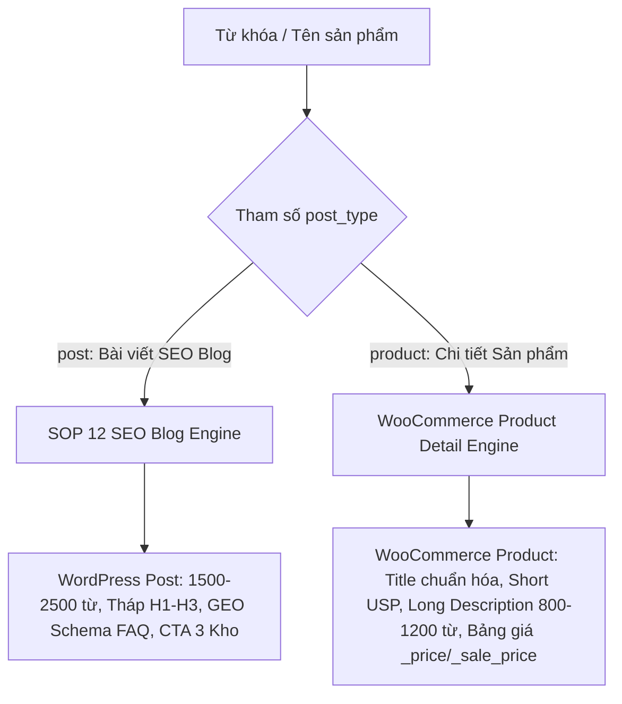

# TÀI LIỆU KIẾN TRÚC & SOP 18: ĐỘNG CƠ HỢP NHẤT ĐA ĐỐI THỦ (CROSS-COMPETITOR SYNTHESIS), CHẾ ĐỘ KÉP SEO BLOG & WOOCOMMERCE PRODUCT, VÀ HÀNG ĐỢI XỬ LÝ HÀNG LOẠT (ASYNC BATCH QUEUE)

> **Mục tiêu**: Chuẩn hóa logic cào dữ liệu từ nhiều đối thủ để bù đắp thông số & giá sàn thực tế, phân tách quy trình tạo bài viết SEO vs trang chi tiết sản phẩm WooCommerce, và cơ chế xử lý hàng loạt danh sách sản phẩm chống timeout.
> **Trạng thái**: Đã vận hành trên Microservice cổng `8085` (`server.py`, `agent_orchestrator.py`, `scraper_tool.py`).

---

## I. LOGIC HỢP NHẤT ĐA ĐỐI THỦ (CROSS-COMPETITOR SYNTHESIS)

### 1. Tại Sao Không Thể Chỉ Cào Một Đối Thủ Duy Nhất?
- **Thiếu hụt thông số kỹ thuật**: Đối thủ A (ví dụ `cuahangtcs.com`) có thể chỉ ghi thông số cơ bản (kích thước, công suất), nhưng bỏ sót thông số chuyên sâu (loại tấm nền QLED/MiniLED, tần số quét 144Hz, âm thanh Dolby Atmos, hệ điều hành HyperOS).
- **Giá bán phân mảnh**: Đối thủ A bán rẻ mặt hàng này, nhưng đối thủ B (`mihanoi.vn`) lại có chương trình flash sale giảm sâu hơn cho mặt hàng khác.
- **Giải pháp Cross-Competitor Synthesis**:
  1. Cào song song nhiều đối thủ kinh doanh cùng một sản phẩm/từ khóa.
  2. Bóc tách chính xác **Giá bán khuyến mãi thực tế (Sale Price - thẻ `<ins>`)** thay vì giá niêm yết ảo (`<del>`).
  3. Đối chiếu và hợp nhất (Merge & Deduplicate): Lấy thông số từ đối thủ đầy đủ nhất bù vào đối thủ thiếu để tạo ra **Bảng thông số toàn diện nhất thị trường (10x Comprehensive Spec Sheet)**.
  4. Tính toán **Giá sàn thấp nhất thị trường (Lowest Market Price)** và đề xuất giá bán TongKhoMi cạnh tranh nhất kèm bảo hành 2 năm.

---

## II. CHẾ ĐỘ KÉP TẠO NỘI DUNG (DUAL-MODE CONTENT GENERATION)

Hệ thống phân tách rõ ràng 2 luồng bài viết chuyên biệt qua tham số `post_type`:



### 1. Chế Độ 1: Bài Viết SEO Blog (`post_type = "post"`)
- **Mục tiêu**: Kéo traffic tự nhiên từ Google Search và Generative Search (ChatGPT Search, Perplexity).
- **Cấu trúc bài viết**:
  - Độ dài: 1500 - 2500 từ.
  - Tháp Heading: 1 thẻ H1 chứa từ khóa chính, tối đa 5 thẻ H2, các thẻ H3 con.
  - **Cam kết 0% từ sáo rỗng AI**: Cấm tuyệt đối *"đáng kinh ngạc", "bức tranh toàn cảnh", "theo dõi sát sao", "tận dụng tối đa"*.
  - Bảng so sánh thông số & giá bán Markdown (chuẩn bị GEO Schema cho AI Engines trích dẫn).
  - 5 câu hỏi thường gặp (FAQ) giải đáp thắc mắc người mua.
  - Bắt buộc nhúng 4 link chính sách (`/chinh-sach-bao-hanh`, `/chinh-sach-doi-tra`, `/tra-cuu-bao-hanh`, `/chinh-sach-van-chuyen`).
  - Kết bài CTA với hotline `0822.83.4444` và địa chỉ 3 kho tại Hà Nội.

### 2. Chế Độ 2: Trang Chi Tiết Sản Phẩm WooCommerce (`post_type = "product"`)
- **Mục tiêu**: Tối ưu tỷ lệ chuyển đổi mua hàng (CRO) và hiển thị trực quan trên gian hàng WooCommerce.
- **Cấu trúc bài viết**:
  - **H1 Tiêu đề chuẩn hóa**: `[Loại SP] + [Model] + [Kích thước/Dung tích] + [Tính năng nổi bật] + [Chính Hãng]`.
  - **Tóm tắt USP ngắn (`===SHORT_DESCRIPTION===`)**: 4-5 bullet points súc tích (Tấm nền, công nghệ làm sạch, bảo hành 2 năm).
  - **Mô tả chi tiết sản phẩm (`===FULL_DESCRIPTION===`)**: 800 - 1200 từ chuẩn CRO, biến tính năng thành lợi ích thực tế, kèm bảng thông số kỹ thuật chi tiết.
  - **Tự động lưu vào WooCommerce**:
    * Post type `product`, status `draft`.
    * Cập nhật meta giá bán: `_price`, `_regular_price`, `_sale_price`.
    * Gắn chuyên mục sản phẩm (`product_cat`).
    * Gắn Rank Math Focus Keyword và SEO Description.

---

## III. HÀNG ĐỢI XỬ LÝ HÀNG LOẠT CHỐNG TIMEOUT (ASYNC BATCH QUEUE)

### 1. Vấn Đề Khi Gửi Danh Sách Nhiều Sản Phẩm
- Mỗi sản phẩm cần cào đa đối thủ, gọi LLM 9Router sinh nội dung 1500 từ và đẩy vào WordPress mất từ 25 đến 45 giây.
- Nếu gửi 1 danh sách 10 - 50 sản phẩm qua kết nối HTTP đồng bộ (Blocking), Dify Chatbot hoặc Client HTTP sẽ bị lỗi **504 Gateway Timeout** hoặc treo giao diện.

### 2. Kiến Trúc Hàng Đợi Bất Đồng Bộ (`POST /api/v1/campaign/batch`)
```
[Client gửi mảng 20 sản phẩm] 
         │
         ▼
[FastAPI: Tạo batch_job_id, Khởi chạy BackgroundTasks] ──► [Phản hồi HTTP 202 Accepted trong 200ms]
         │
         ▼ (Chạy ngầm)
[Worker duyệt tuần tự 1/20 ➔ 2/20 ➔ 20/20]
  ├── Cào đối thủ (Tier 3)
  ├── 9Router Multi-Agent (Tier 2 & 4)
  └── Xuất bản WordPress (Tier 5)
         │
         ▼
[Cập nhật trạng thái vào in-memory JOBS_DB: progress '20/20', status 'completed']
```

- **Tra cứu tiến độ**: `GET /api/v1/jobs/{job_id}` trả về:
  ```json
  {
    "job_id": "batch_98a7bc12",
    "total_items": 20,
    "status": "processing",
    "progress": "8/20",
    "current_step": "Đang viết bài cho sản phẩm #9: Robot hút bụi Dreame L20...",
    "results": [...]
  }
  ```

---

## IV. LỊCH BIÊN TẬP 30 NGÀY TỰ ĐỘNG (AUTOPILOT ENGINE)

Thực thi tại [`autopilot_runner.py`](file:///home/ubuntu/michinhhang/dify-integration/autopilot/autopilot_runner.py):
- Nạp danh mục từ khóa theo lịch 30 ngày từ `seo_calendar_30days.json`.
- Quản lý trạng thái luân chuyển hàng ngày qua `autopilot_state.json`.
- Tự động gọi Dify Workflow hoặc 9Router fallback, xuất bản bài nháp lên WordPress và lưu kịch bản video TikTok 60s vào `autopilot/campaigns/`.
