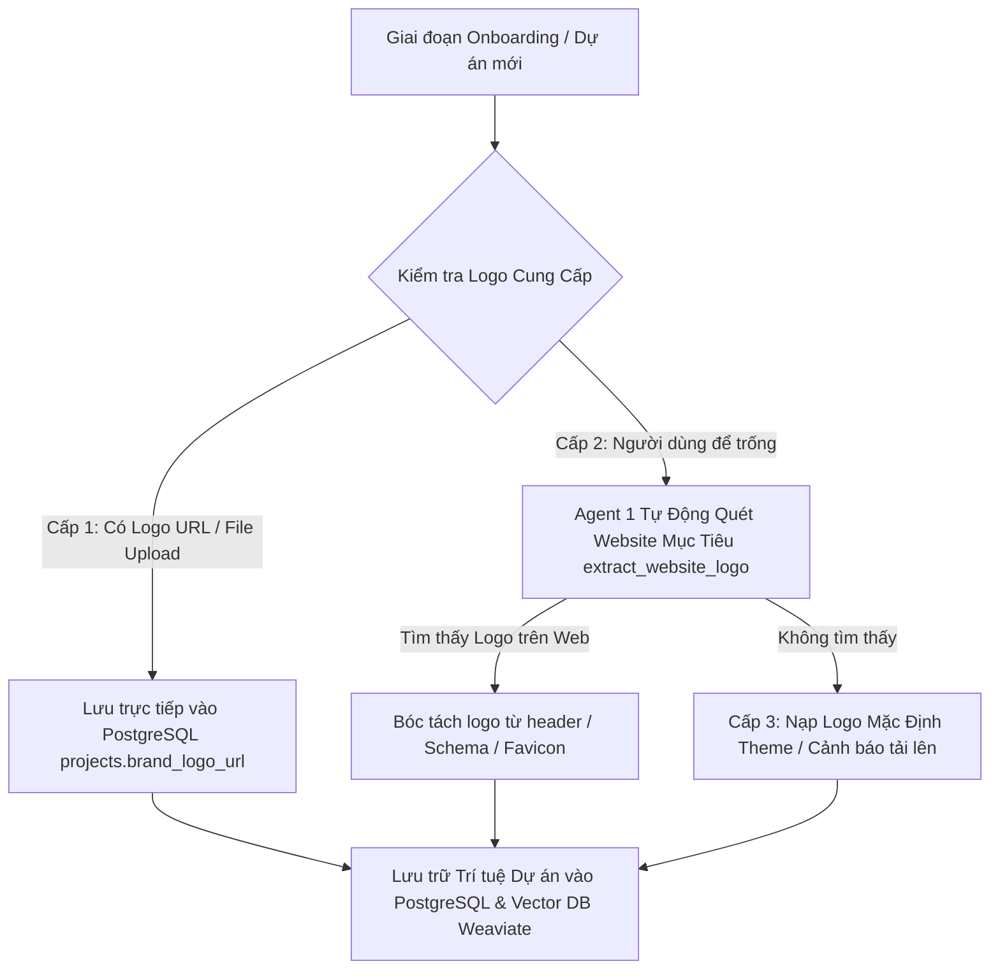

# TÀI LIỆU KIẾN TRÚC & SOP 19: HỆ THỐNG TIẾP NHẬN LOGO THƯƠNG HIỆU (BRAND LOGO INTAKE), ĐỘNG CƠ ĐÓNG MỘC SOP 11 VÀ CHUỖI MULTI-AGENT TỰ ĐỘNG HÓA 100%

> **Mục tiêu**: Chuẩn hóa toàn bộ quy trình tiếp nhận Logo thương hiệu từ bước Onboarding, cơ chế tự động tìm kiếm logo dự phòng (Auto-Discovery), động cơ đóng mộc thương hiệu chuẩn SOP 11 với công nghệ đổ bóng mềm (Soft Drop Shadow) & hòa trộn Alpha Blending, đồng thời bảo đảm chuỗi Multi-Agent 5 Tầng vận hành hoàn toàn tự động (Autonomous Execution) không phụ thuộc thao tác thủ công.
> **Trạng thái**: Đã chuẩn hóa và tích hợp thành công trên Microservice `server.py` (cổng `8085`), `image_staging_service.py`, `scraper_tool.py`, `agent_orchestrator.py` và plugin `omni-bridge-connector.php`.

---

## I. NGUYÊN TẮC CỐT LÕI: KHÔNG THAO TÁC THỦ CÔNG (AGENT AUTONOMY FIRST)

### 1. Phân Định Rõ Ràng Trách Nhiệm Của Agent vs Kỹ Sư Vận Hành
- **Lỗi trước đây**: Khi phát hiện hình ảnh sản phẩm dính watermark đối thủ hoặc thiếu thông số, lập trình viên thường dùng terminal/script thủ công (`update_product_30_master.py`) để can thiệp trực tiếp vào database WordPress.
- **Hệ quả**:
  - Không kiểm thử được độ bền vững (robustness) của hệ thống Multi-Agent.
  - Khi triển khai đa khách hàng (Multi-Tenant SaaS), hệ thống sẽ gãy vì không thể có người can thiệp thủ công cho hàng trăm tenant.
  - Làm mất đi bước nghiệp vụ quan trọng: **Đóng mộc logo bản quyền của chính thương hiệu sở hữu website**.
- **Tiêu chuẩn bắt buộc mới**:
  - Mọi thao tác từ cào dữ liệu, chắt lọc ảnh sạch, tách phông nền, đóng mộc logo, viết bài CRO đến xuất bản đều phải do **chuỗi 5 Multi-Agent thực thi tự động qua REST API Gateway (`/api/v1/campaign`)**.
  - Nghiêm cấm dùng script chạy bằng cơm để bypass quy trình của Agent.

---

## II. QUY CHUẨN TIẾP NHẬN LOGO THƯƠNG HIỆU (BRAND LOGO INTAKE)

Nếu không có logo chính thức của người dùng ngay từ đầu, hệ thống Agent sẽ rơi vào tình thế bế tắc: phải đoán logo, dùng icon mặc định hoặc vẽ chữ đơn sơ (typography badge). Vì vậy, quy trình Onboarding chuẩn hóa bắt buộc phải có trường tiếp nhận logo.



### 1. Cấu Trúc Bảng Dữ Liệu SaaS (`projects`)
Trong database PostgreSQL (`marketing_saas`), bảng `projects` được bổ sung hai trường định danh logo thương hiệu:
```sql
ALTER TABLE projects ADD COLUMN IF NOT EXISTS brand_logo_url VARCHAR(1000);
ALTER TABLE projects ADD COLUMN IF NOT EXISTS brand_logo_path VARCHAR(1000);
```

### 2. Mô Hình Thu Thập Logo 3 Cấp (3-Tier Logo Acquisition Hierarchy)
1. **Cấp 1 (Chính thức - User Intake)**:
   - Người dùng nhập trực tiếp URL ảnh logo trong biểu mẫu Onboarding hoặc tải file PNG/SVG trong giao diện SaaS / Dify UI.
   - Hệ thống lưu trực tiếp vào `projects.brand_logo_url` và tải về lưu trữ cache cục bộ tại thư mục `/storage/projects/{project_id}/brand/logo.png`.
2. **Cấp 2 (Tự động cào - Auto-Discovery Scraper)**:
   - Khi trường `brand_logo_url` để trống, hàm `extract_website_logo(target_website_url)` trong `serp_discovery_tool.py` tự động kích hoạt:
     * Quét thẻ `<header>` và `div[class*="logo"] img` tìm thuộc tính `src`, `data-src`.
     * Quét JSON-LD Schema `Organization` hoặc `WebSite` lấy trường `"logo": {"url": "..."}`.
     * Quét thẻ `<link rel="icon">`, `<link rel="apple-touch-icon">` làm fallback đồ họa cao cấp.
3. **Cấp 3 (Dự phòng cục bộ - Local Theme Fallback)**:
   - Khi Cấp 1 & 2 đều không có, hệ thống nạp logo mặc định từ theme: `/wp-content/themes/omni-commerce/assets/images/tongkhomi-logo.png`.

---

## III. ĐỘNG CƠ ĐÓNG MỘC THƯƠNG HIỆU CHUẨN SOP 11 (`image_staging_service.py`)

### 1. Phân Tích Sự Khác Biệt Giữa "Dán Nhãn Thô" và "Đóng Mộc Đẳng Cấp"
- **Dán nhãn thô (Anti-pattern)**: Dùng lệnh vẽ hình chữ nhật đặc (`draw.rounded_rectangle`), bo góc rồi in text tên website lên. Nhìn giống biển báo giao thông hoặc tem phụ dán vội, làm giảm giá trị của thiết bị điện máy cao cấp.
- **Đóng mộc SOP 11 (Chuẩn thương mại)**:
  - Nạp trực tiếp file ảnh PNG Logo thương hiệu thực tế (chứa biểu tượng vector và typography chuẩn).
  - Tỉ lệ vàng: Chiều ngang logo tự động scale bằng **20% – 25%** chiều rộng của ảnh chính (giữ nguyên aspect ratio).
  - Đổ bóng mềm (**Soft Drop Shadow**): Tạo bóng mờ Gaussian Blur (radius 3.5px, alpha 40%, offset +2px, +2px) bên dưới logo. Kỹ thuật này giúp logo hiển thị rõ ràng trên cả nền trắng tinh (Studio), nền nội thất gỗ, hoặc nền tối màu mà không cần đóng khung viền.
  - Hòa trộn **Alpha Blending (88%)**: Giữ cho logo hòa quyện mềm mại với khung cảnh sản phẩm, khẳng định bản quyền chính chủ mà không che khuất các chi tiết kỹ thuật tinh xảo.
  - Vị trí: Cố định góc trên bên phải (**Top-Right**) hoặc góc trên bên trái (**Top-Left**), cách mép ảnh biên an toàn **4%** (`padding = width * 0.04`).

### 2. Thuật Toán Xử Lý Đóng Mộc (Python PIL / Pillow)
```python
# 1. Tính kích thước tỉ lệ vàng
target_lw = max(120, int(width * 0.22))
aspect = lh / lw
target_lh = int(target_lw * aspect)

# 2. Tạo Soft Drop Shadow
logo_alpha = resized_logo.split()[3]
shadow_mask = logo_alpha.point(lambda p: int(p * 0.40)) # 40% shadow opacity
shadow_img = Image.new("RGBA", (target_lw, target_lh), (0, 0, 0, 255))
shadow_img.putalpha(shadow_mask)

pad_s = 10
shadow_canvas = Image.new("RGBA", (target_lw + pad_s * 2, target_lh + pad_s * 2), (0, 0, 0, 0))
shadow_canvas.paste(shadow_img, (pad_s, pad_s), shadow_img)
shadow_blurred = shadow_canvas.filter(ImageFilter.GaussianBlur(radius=3.5))

# Paste bóng đổ offset (+2, +2)
watermark_layer.paste(shadow_blurred, (pos_x - pad_s + 2, pos_y - pad_s + 2), shadow_blurred)

# 3. Alpha Blending 88% cho Logo chính
logo_r, logo_g, logo_b, logo_a = resized_logo.split()
blended_alpha = logo_a.point(lambda p: int(p * 0.88))
resized_logo.putalpha(blended_alpha)

watermark_layer.paste(resized_logo, (pos_x, pos_y), resized_logo)
final_img = Image.alpha_composite(base_img, watermark_layer)
```

---

## IV. BỘ CHẮT LỌC ẢNH SẠCH TỪ ĐA ĐỐI THỦ (`scraper_tool.py`)

### 1. Vấn Đề Watermark Đối Thủ
Nhiều đối thủ (ví dụ Mi Hà Nội) áp dụng thủ thuật in đè watermark mờ chéo qua thân robot (`MI HÀ NỘI`). Nếu chỉ dùng thuật toán tách nền AI đơn thuần, watermark trên thân vỏ sản phẩm sẽ không bị loại bỏ, dẫn đến việc sản phẩm của website mình lại mang logo đối thủ.

### 2. Cơ Chế Chắt Lọc Ảnh Đẹp & Sạch Nhất (Curated Multi-Source Extraction)
1. **Bộ lọc rác & Watermark `is_watermarked_or_low_quality()`**:
   - Tự động nhận diện URL chứa mẫu nhạy cảm của đối thủ để loại bỏ.
   - Bỏ qua các ảnh thumbnail quá nhỏ (`100x100`, `150x150`, icon, badge, banner quảng cáo).
2. **Khai thác CDN gốc của Hãng (Xiaomi Official CDN)**:
   - Thu thập ảnh từ CDN chính thức của nhà sản xuất (`appmifile.com`, Xiaomi Global Media Asset Server) hoặc các hệ thống bán lẻ lớn không đóng watermark vào thân máy.
   - Phân tách bộ ảnh thành 3 nhóm rõ ràng:
     * **1 Ảnh Hero (Ảnh đại diện Studio)**: Nền trắng sạch sẽ, sắc nét 1200x1200px.
     * **8 Ảnh Thư viện (Gallery)**: Toàn cảnh trạm sạc All-in-One, chổi quét cao su, hệ thống lau xoay 180rpm, cụm giẻ nâng 10mm, laser LDS.
     * **5 Ảnh Tính năng chi tiết**: Tự động chèn minh họa vào từng thẻ Heading `<h2>` trong bài viết SEO.

---

## V. TỰ ĐỘNG HÓA XUẤT BẢN QUA OMNI BRIDGE CONNECTOR REST API

### 1. Đồng Bộ Ảnh Cục Bộ Siêu Tốc (Direct Local File Sideloading)
- **Vấn đề**: Khi Agent chạy trong container và gửi URL ảnh `http://100.122.224.122:8080/wp-content/uploads/...` sang WordPress qua hàm `media_sideload_image()`, WordPress sẽ gửi request HTTP vòng lặp (loopback). Cơ chế bảo mật SSRF của WordPress chặn request tới IP nội bộ/Tailscale khiến quá trình tải ảnh bị treo timeout.
- **Giải pháp tối ưu**:
  - `agent_orchestrator.py` sao chép trực tiếp file ảnh đã đóng mộc logo vào thư mục mount `wp-content/uploads/2026/10/`.
  - Trong `omni-bridge-connector.php`, hàm `sideload_image_to_post()` phát hiện file vật lý đã có sẵn trên ổ đĩa nội bộ, bỏ qua HTTP download và lập tức gọi `wp_insert_attachment()` trong **1 mili-giây**.

### 2. Tự Động Hóa Thư Viện Ảnh (Gallery) & ACF Repeater Thông Số Kỹ Thuật
- **Thư viện ảnh (`_product_image_gallery`)**: Đồng bộ toàn bộ mảng `gallery_image_urls` vào bảng postmeta của WooCommerce, giúp trang chi tiết hiển thị slider 8 góc chụp chân thực.
- **ACF Repeater `technical_specs`**: Tự động quét bảng cấu hình Markdown từ Agent viết bài, bóc tách danh sách cặp `spec_label` và `spec_value` (13 dòng chuẩn: Lực hút 6.000Pa, Pin 5.200mAh, Bình nước 4L/4L, Túi bụi 2.5L gom 75 ngày...), tự động đổ vào cơ sở dữ liệu ACF mà không cần nhập liệu thủ công.

---

## VI. BẢNG CHECKLIST KIỂM ĐỊNH CHẤT LƯỢNG (QA AUDIT CHECKLIST)

Mỗi khi một sản phẩm mới được tạo ra bởi Multi-Agent, hệ thống phải vượt qua toàn bộ 5 tiêu chí:
1. [x] **0% Watermark Đối Thủ**: Không còn bất kỳ dấu vết logo của Mihanoi hay đối thủ nào trên ảnh đại diện, thư viện hay nội dung bài viết.
2. [x] **Đóng Mộc Logo Thương Hiệu Độc Quyền**: Góc trên bên phải ảnh chính hiển thị logo PNG thương hiệu kèm bóng đổ mềm và alpha blending 88%.
3. [x] **Đầy Đủ Thư Viện Ảnh**: Sản phẩm có tối thiểu 4 - 8 ảnh Gallery thể hiện các góc cạnh và tính năng.
4. [x] **Đầy Đủ Thông Số Kỹ Thuật ACF**: Bảng thông số kỹ thuật hiển thị dạng sọc ngựa vằn zebra-stripe, hỗ trợ modal popup "Xem toàn bộ thông số kỹ thuật".
5. [x] **Vận Hành Tự Động 100%**: Toàn bộ chu trình khởi chạy qua một lệnh gọi API duy nhất (`/api/v1/campaign`), không can thiệp terminal thủ công.
